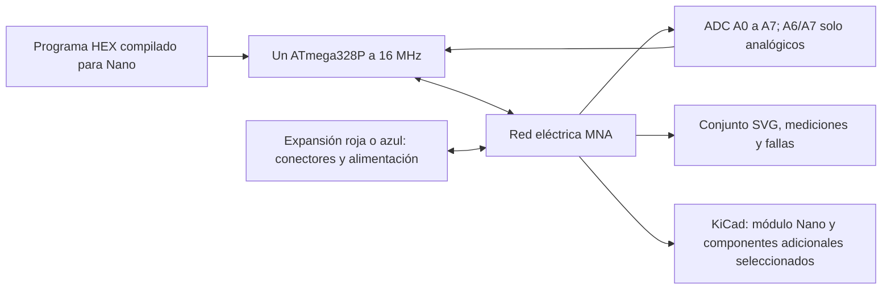

# Nano clásico + expansión E/S — implementación de Codex

11 de octubre de 2026. Encargo de Efraín, después del cierre de R1–R8. Codex asume implementación, pruebas y revisión. El software integra `nano` y `nano_old` con expansión roja/azul; **la validación física de ambos conjuntos está pendiente**. Las fotos se usaron como referencias locales de apariencia y no se incorporaron al repositorio.

## Cómo está separado el conjunto

`placas.js` define capacidades, pines y aliases; `chip.js` usa ese perfil para GPIO y ADC. El Nano antiguo conserva exactamente el mismo chip, reloj y pines: cambia el cargador usado por Arduino CLI al subirlo a la placa. El lienzo dibuja el módulo y una expansión montada; no crea un segundo Arduino. El Worker ejecuta el núcleo sin depender del DOM.

La expansión tiene 85 terminales. En D0–D13 y A0–A7 cada grupo ofrece señal, 5V y GND. I2C llega a A4/A5; SPI a D12/D11/D13/D10; UART a D1/D0. Los aliases no agregan GPIO ni agujeros al Nano. A6/A7 llegan al ADC y no tienen `digitalWrite`, PWM ni pull-up interno. El [pinout oficial de Arduino](https://docs.arduino.cc/resources/pinouts/A000005-full-pinout.pdf) respalda las capacidades y la distribución; el dibujo SVG es original.

Roja y azul usan IDs de terminales estables. Sus coordenadas y colores pueden variar sin cambiar las redes, por lo que cambiar de variante conserva las conexiones. La geometría parte de 58 × 54 mm como referencia anunciada para la roja; no es un plano mecánico certificado de ambas tarjetas. Abrir un Nano guardado sin expansión conserva ese montaje; crear uno nuevo agrega la expansión por defecto. La biblioteca ofrece las piezas compatibles y rechaza una segunda expansión o un montaje en la protoboard.

## Alimentación que se puede probar en software

`alimentacion_nano.js` contiene un modelo propio de referencia. No usa las mediciones de 5,11 V, 1,66 Ω, reposo ni fusible del Uno. Sus valores se declaran como supuestos:

| Parámetro | Referencia adoptada | Evidencia pendiente |
|---|---|---|
| USB / salida de 5V | 5V nominales | Medir cada Nano, cable y tarjeta |
| Consumo del conjunto en reposo | 25mA | Medir con el programa y montaje identificados |
| Resistencia de fuente / salida 3,3V | 0,25Ω / 0,5Ω | Curvas de carga reales |
| Margen de regulación externa | 1,2V | Identificar reguladores y medir caída |
| Margen de 3,3V del módulo | 0,3V | Identificar USB/regulador del clon |
| Umbral de reinicio | 2,7V | Comprobar fuses y caída real |
| Aviso de carga externa 3,3V | 100mA | Es un umbral del modelo, no capacidad acreditada de la tarjeta |

Se elige USB, jack o desconectada. La selección pertenece al simulador; no afirma que las tarjetas comerciales tengan ese interruptor. En jack puede elegirse un voltaje de referencia o conectar una LiPo existente; el cableado de la batería tiene prioridad. Las cargas de 5V y 3,3V participan en las caídas, también las cargas conectadas directamente a la entrada. Un corto o una batería invertida apaga la alimentación del jack en vez de recuperar el valor de la propiedad.

`JACK_POS` es la entrada privada del regulador externo, distinta de `Nano.VIN`. `OUT_3V3` es la salida de regulación externa, distinta del `Nano.3V3`. Todas las tierras sí son comunes. Separar esas redes evita poner en paralelo los reguladores del módulo y de la expansión. El pinout de Arduino publica 50mA para el 3,3V del módulo original; no extender ese valor al regulador externo ni a todos los clones.

En realista, `limiteUSB` activa las caídas y el umbral de referencia del Nano; en ideal se conservan nominales mientras existe una fuente válida. El chip espera cuando falta energía, pero el reloj de los modelos sigue avanzando, incluidos pasos parciales. Al reconectar la fuente, el HEX comienza de nuevo. El voltaje de alimentación también llega a MNA, al nivel de los GPIO y a la referencia del ADC. La interfaz identifica las mediciones como referencia por validar.

No se simulan temperatura de reguladores, limitación térmica, protección contra polaridad, aislamiento físico USB/jack, selección automática de fuentes ni transitorios de condensadores. Los periféricos de protocolo I2C/SPI y los dispositivos conectados a esos buses siguen fuera de este encargo; sí se validan sus conexiones y redes exportadas.

## Qué lleva la netlist de KiCad

El Nano sale como `MCU_Module:Arduino_Nano_v3.x`, huella `Module:Arduino_Nano`, 30 pads. El ATmega, USB y electrónica interna permanecen dentro del módulo. Del conjunto con expansión se añaden diez piezas:

| Elementos | Función y conexión de referencia |
|---|---|
| LD1117S50TR en SOT-223 | Jack → 5V común |
| LD1117S33TR en SOT-223 | 5V → 3,3V externo |
| Tres condensadores 10µF/25V | Entrada del jack, salida 5V, salida 3,3V |
| Dos condensadores 100nF | Desacoplo del jack y de 5V |
| Jack PJ-102AH | Centro positivo, tierra, contacto conmutado sin red |
| Header I2C de cuatro pines | SDA, SCL, 5V, GND |
| Header SPI de seis pines | MISO, MOSI, SCK, SS, 5V, GND |

Los reguladores son una elección de diseño, no una identificación de las fotos. La [hoja de datos de ST LD1117](https://www.st.com/resource/en/datasheet/ld1117.pdf) respalda el pinout SOT-223 y el condensador mínimo de 10µF. La [ficha del jack PJ-102AH](https://www.sameskydevices.com/product/resource/pj-102ah.pdf) es la referencia de su huella y contactos; comprobar la pieza adquirida.

Cada elemento adicional lleva una nota `TecnoCircuito_validacion` con los pendientes. La netlist conserva los componentes normales del circuito y elimina la protoboard/cables como objetos: quedan sus redes. Los headers GVS/UART de la expansión no generan huellas adicionales. El exportador no entrega esquemático ni PCB terminada, y no añade una protección de fuentes que no se haya elegido y validado. Antes de alimentar por USB y jack a la vez, hay que resolver su aislamiento en el diseño físico.

## Pruebas y lectura de la evidencia

Las pruebas nuevas están incluidas en `npm.cmd run probar`. Verifican perfiles, equivalencia de pines y aliases, A6/A7 mediante un HEX compilado con Arduino CLI, fuentes/cargas/cortos, reloj apagado, reinicio y preservación del Uno. El recorrido Chromium comprueba ambas variantes, Worker, perillas, persistencia, SVG autónomo y netlist. Las pruebas de KiCad cargan símbolos y huellas reales, comprueban pads/redes, guardan y reabren una placa y ejecutan DRC.

La placa de comprobación tiene las huellas separadas y las conexiones pendientes de enrutar. Un DRC sin infracciones de huella no demuestra ruteo completo, capacidad térmica ni compatibilidad con el hardware comercial. Los conteos de la ejecución final y la integración Electron/Arduino CLI de TecnoBloques se registran en [BITACORA.md](../BITACORA.md).

**Resultado final:** suite completa **945 OK, cero fallas**, 23 grupos, incluidos 13 recorridos Chromium y las dos pruebas con KiCad real. Casos nuevos: núcleo Nano **93**, netlist Nano **59**, KiCad Nano **80**, interfaz Nano **76**; contrato ampliado **100**. Los informes DRC de Nano suelto/roja/azul tienen cero infracciones y 32/30/30 conexiones pendientes de enrutar. TecnoBloques: integración **51**, graficador **28** y pruebas generales exit 0 con registros de errores vacíos. Verificación de software, sin mediciones físicas nuevas.

**Comprobación manual de Efraín (11 oct):** abrió la app con `npm run app:simulador` y confirmó que el programa corre y mide de manera independiente los dos potenciómetros en A6/A7. Queda validado ese recorrido de uso del simulador; no es una medición del hardware. Autorizó commit y push después de la comprobación.

## Validación física, una práctica a la vez

1. **Identificación y continuidad, sin alimentar.** Registrar variante, Nano/clon, componentes marcados, jack, diámetro y dimensiones. Medir cada GVS e I2C/SPI; comprobar GND y la separación o unión real de jack/VIN y ambas salidas 3,3V. No asumir que el color identifica un esquema único.
2. **Fuente única y salidas sin carga.** Tras confirmar polaridad y límites de la tarjeta, usar USB o una fuente de jack limitada en corriente, una por vez. Medir entrada, 5V y ambas salidas 3,3V. Documentar cualquier selección automática o retorno de corriente.
3. **Carga resistiva gradual.** Medir reposo y luego 5V/3,3V con resistencias dimensionadas para potencia y límites identificados. Estimar impedancia, caída y disipación. No usar un cortocircuito ni una batería invertida como prueba de banco; esos casos se comprueban en software.
4. **Programa A6/A7.** Desde TecnoBloques abrir el ejemplo Nano, usar el mismo C++ en hardware y simulador, comparar varios puntos de cada potenciómetro y guardar serial/voltajes con la resolución instrumental. A6/A7 no se prueban como salidas digitales.
5. **Funciones compartidas.** Repetir LED/botón/PWM/servo usando conectores de expansión y luego pines del módulo. Verificar por continuidad I2C/SPI y, con el dispositivo real y analizador lógico, niveles y orden; esto no convierte al simulador en un modelo de esos dispositivos.
6. **Montaje de KiCad.** Comparar los 30 pads, USB, orientación, paso, ancho de filas, jack y conectores contra la pieza física. Resolver protección/aislamiento y disipación antes del ruteo; después ejecutar DRC y revisar fabricación. Repetir para roja y azul.

Cada registro distingue dato medido, ajuste y supuesto. Aplicar los criterios existentes ±5 % en voltaje, ±10 % en corriente y ±1 % en tiempos, con la medida como denominador y el margen instrumental informado aparte. No ajustar tolerancias para aprobar; calibrar parámetros con datos trazables y conservar pruebas de regresión. Solo esos registros permiten cerrar la validación física.
