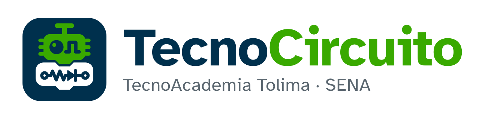

# Marca TecnoCircuito



## La idea

**El mismo robot de TecnoBloques, pero ahora es un chip sobre su circuito.** En TecnoBloques los bloques se vuelven un robot; en TecnoCircuito ese robot se conecta a un circuito real y el programa lo hace funcionar.

| Elemento | Qué dice |
|---|---|
| Dos bloques que encajan (pestaña y muesca) | **Familia TecnoBloques**: el programa de bloques encaja con el circuito |
| Cabeza con patas a los lados | **El chip**: el microcontrolador que ejecuta el programa, sea cual sea la tarjeta |
| Ojo LED | **La salida**: lo que el circuito muestra |
| Ojo pulso (onda cuadrada) | **La señal**: lo que el chip manda por sus pines |
| Pista: vía, resistencia, LED, vía | **El circuito** que arma el aprendiz (la tarea T1) |
| Antena en forma de T | **TecnoAcademia** (la misma de TecnoBloques) |

Las dos marcas son hermanas: misma cuadrícula, mismos bloques redondeados, misma antena y mismos colores. Se distinguen a simple vista por las patas del chip y por la pista de circuito en lugar del `</>`.

## Colores

Los mismos de TecnoBloques (paleta institucional SENA).

| Color | Código | Uso |
|---|---|---|
| Verde SENA | `#39A900` | Cabeza (chip), palabra «Circuito» |
| Azul SENA | `#00304D` | Fondo del ícono, ojos y pista, palabra «Tecno» |
| Blanco | `#FFFFFF` | Cuerpo sobre fondos oscuros |
| Verde claro | `#5fd12a` | «Circuito» sobre fondo oscuro |

Antes de imprimir material oficial, confírmalos con el manual de identidad del SENA.

## Tipografía

**Atkinson Hyperlegible**, en negrita para el nombre (libre, licencia OFL; copia en `fuentes/`). El nombre se escribe junto: **Tecno** (azul o blanco) + **Circuito** (verde). Debajo, la línea de respaldo **TecnoAcademia Tolima · SENA**. En los SVG el texto ya es trazado: se ven igual sin tener la fuente instalada.

## Archivos

| Archivo | Para qué |
|---|---|
| `svg/simbolo-app.svg` | **Logo cuadrado** (símbolo sobre fondo azul). App, web, materiales |
| `svg/simbolo-cabeza.svg` | Solo el chip, para 16–24 px (pestaña del navegador) |
| `svg/simbolo-sobre-claro.svg` / `simbolo-sobre-oscuro.svg` | Símbolo sin fondo, según el fondo donde va |
| `svg/una-tinta-azul.svg` / `una-tinta-blanca.svg` | Una sola tinta: stickers, grabado láser, impresión económica |
| `svg/logo-horizontal.svg` / `logo-horizontal-oscuro.svg` | **Banner horizontal**: símbolo + nombre, para fondos claros / oscuros |
| `svg/firma.svg` | **Firma**: «Hecho con:» + banner horizontal + la frase. Abajo a la derecha de la imagen que exporta el lienzo |
| `svg/chip-serigrafia.svg` | **Chip de serigrafía**: el chip solo, en dos colores de referencia (`#FFFFFF` tinta, `#000000` ojos) que cada placa cambia por los suyos. Su viewBox es la caja exacta del dibujo, con la antena |
| `png/icono-<tamaño>.png` | 16 a 1024 px (16 y 24 usan solo el chip) |
| `png/logo-horizontal.png` / `logo-horizontal-oscuro.png` | Banner horizontal en PNG (el del README) |
| `png/compartir.png` | 1200 × 630, para compartir enlaces y la vista previa de GitHub |

## Frase

**Prueba tu idea antes de armarla en la placa.** Va en la firma y en la imagen para compartir, debajo de «Simulador de electrónica y robótica.».

## Dentro de TecnoBloques

TecnoBloques es la casa y TecnoCircuito firma donde trabaja (decisión de Efraín, 25 oct 2026, MARCA-001). Pocos lugares, bien hechos:

- **Panel Circuito:** el chip solo, a 18 px, y «TecnoCircuito» con los colores de la interfaz. La versión y la frase, al pasar el mouse.
- **«Acerca de»** (clic en el logo de TecnoBloques): las dos marcas del mismo tamaño, con su versión, y una sola línea de respaldo.
- **Imagen exportada:** el símbolo de una tinta como marca de agua tenue (10 %) **encima** del circuito, y la firma abajo a la derecha. Encima y no detrás: la placa y las piezas son opacas y la taparían (decisión de Efraín, 25 oct, tras la verificación de Codex).
- **No:** pantalla de bienvenida, marca de agua en el lienzo mientras se trabaja, logo en la barra de título ni colores de TecnoCircuito en la interfaz de TecnoBloques.

## En la serigrafía de las placas

Una marca dentro del dibujo de la placa sobrevive a un recorte, como el logo del fabricante en una placa real (MARCA-002, decisión de Efraín, 25 oct 2026):

- **El chip solo**, en una tinta: blanco de serigrafía (`#F6FCFC`) con los ojos del color de la placa; en la protoboard, azul `#00304D` con los ojos del color del canal.
- **Al 80 % del alto de la marca vecina** y en un espacio libre, sin tocar pines, rótulos ni LEDs. **Una por placa.**
- **Uno:** 4,2 mm, a la izquierda de «1st». **Shield L293D:** 2,8 mm, después de «Rev4», girado como el texto. **Expansión roja y azul:** 2,8 mm, entre el jack y el zócalo del Nano. **Protoboard:** en el canal central, a la derecha.
- **Sin marca:** el Nano (no hay espacio libre) y el probador LiPo (a ese tamaño no se leería). Tampoco las piezas chicas: LED, resistencia, potenciómetro, pulsador, servo, motor y batería.
- Las placas de TecnoDiseñador lo dibujan con `Lienzo.marca_tc()`, que lee `svg/chip-serigrafia.svg` desde la carpeta hermana; la protoboard lo recibe del lienzo.

Los dibujos llegan en el paquete, como `TecnoCircuito.MARCA` (contrato, sección 2): `prototipo/src/marca.js` los toma de `svg/` al construir. Después de cambiar la marca hay que volver a construir el paquete.

**Todo sale de `generar.py`.** Para cambiar la marca se edita ese archivo y se corre `python marca/generar.py` (necesita `playwright` con Chromium, `uharfbuzz` y `fonttools`).

**En el README:**

```html
<p align="center"></p>
```

En GitHub, la imagen de vista previa se sube en Settings → Social preview con `png/compartir.png`.

## Reglas de uso

- Deja alrededor del símbolo un espacio libre de al menos la altura de la antena.
- Tamaño mínimo: el símbolo completo desde 32 px; por debajo, usa el chip solo.
- No cambies los colores, no estires el dibujo, no le agregues sombras ni contornos, y no pongas el símbolo verde-azul sobre fondos verdes (usa la versión de una tinta).
- El logo del SENA no se mezcla dentro del símbolo. Si una pieza lleva ambos, van separados según el manual del SENA.
- Si TecnoCircuito aparece junto a TecnoBloques, se muestran del mismo tamaño y con el mismo espacio entre ellos.
