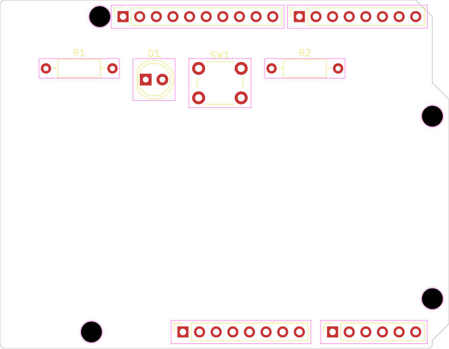
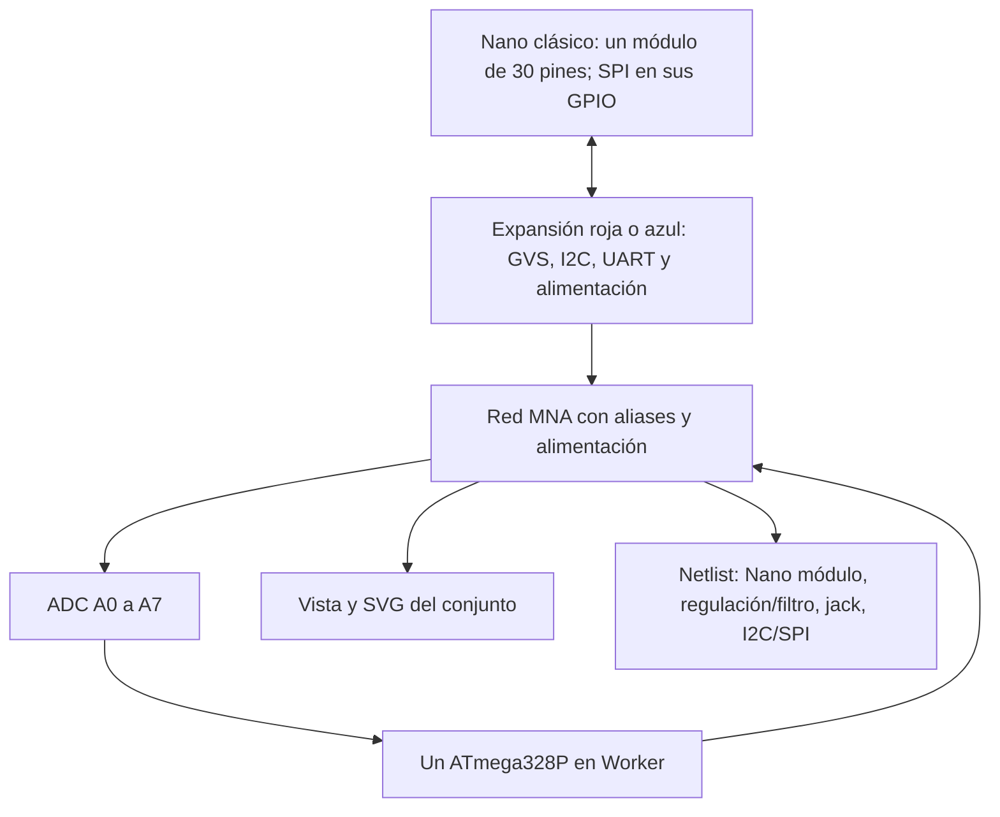
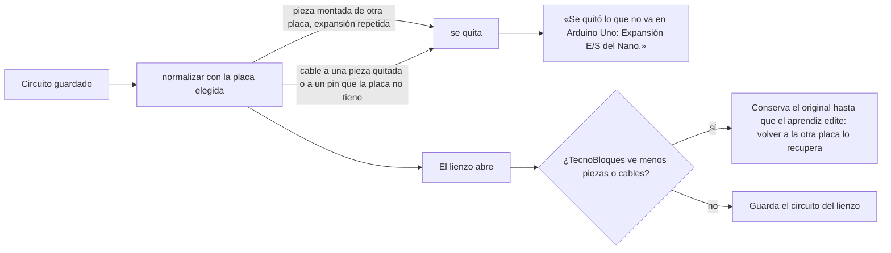
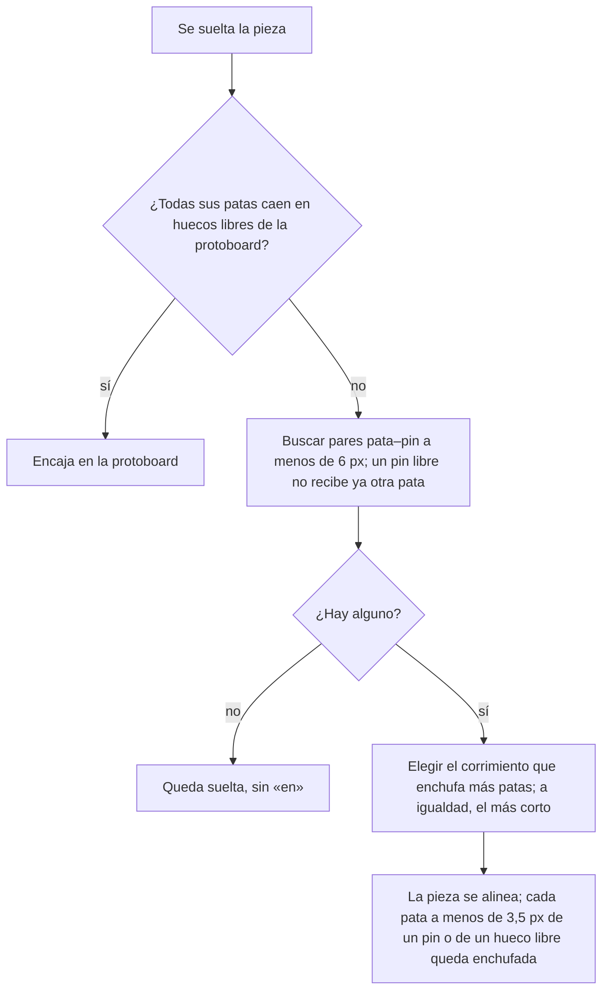
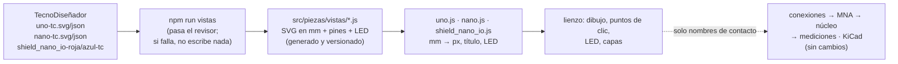
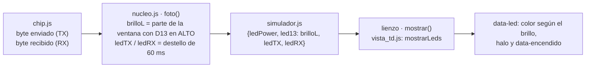
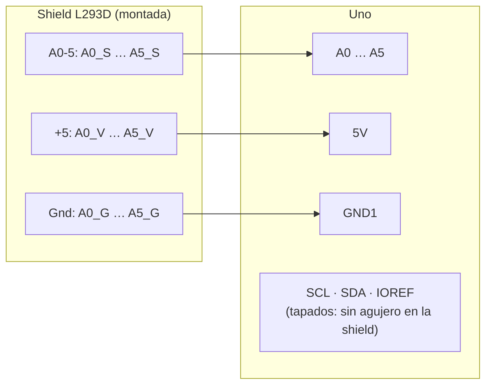

# Cómo funciona el prototipo 0

> Explicación del lienzo de cableado: qué hace cada archivo, cómo se arma y cómo se ejecuta.
> Escrita el 7 de octubre de 2026. Los números de línea de `src/lienzo.js` están al día con el prototipo 4.

## 1. Vista general

Hay dos momentos: cuando se **construye** el archivo y cuando **corre** en el navegador.

```
CONSTRUCCIÓN  (npm run construir → construir.js)
┌──────────────────┐
│ src/index.js     │──┐
│ src/lienzo.js    │  │   esbuild junta todo,        ┌─────────────────────────┐   se mete en    ┌──────────────────────┐
│ src/lienzo.css   │  ├─► lo minimiza y lo envuelve ─►│ dist/tecnocircuito.js   │─► pagina.html ─►│ dist/prototipo.html  │
│ src/catalogo.js  │  │   en un IIFE                  │ 69 KB: código + Lit     │   (<script>)    │ un archivo, sin red  │
│ 3 dibujos wokwi  │──┘                               │ + 3 dibujos             │                 └──────────────────────┘
└──────────────────┘                                  └─────────────────────────┘

EJECUCIÓN
┌──────────────────────────────┐   crearLienzo(elemento, {placa, circuito, alEvento})   ┌───────────────────────────────┐
│ pagina.html (banco de prueba)│ ──────────────────────────────────────────────────────► │ LIENZO                        │
│  · localStorage  ◄─ guardar  │ ◄───────── alCambiar(circuito completo) ─────────────── │  datos ......... la verdad    │
│  · panel JSON    ◄─ mostrar  │ ◄───────── alEvento({t, origen, tipo, datos}) ──────── │  dibujo ........ se deriva    │
│  · lista eventos ◄─ anotar   │                                                         │  interacción ... puntero/tecla│
└──────────────────────────────┘                                                         └───────────────────────────────┘
        En TecnoBloques, este papel lo hará app.js (guardar en el .tbq.json y escribir el registro .jsonl)
```

| Archivo | Qué hace |
|---|---|
| [src/index.js](src/index.js) | Define `window.TecnoCircuito` con `VERSION`, `CONTRATO`, `PLACAS` y `crearLienzo`. Es lo único que se ve desde afuera. |
| [src/catalogo.js](src/catalogo.js) | Solo datos de las piezas: qué dibujo de wokwi usa cada una, cómo se traducen sus pines al contrato (`'GND.1'` → `GND1`, `'A'` → `anodo`), el texto de cada rótulo, las propiedades por defecto, el campo que se edita en la barra y `aplicar()`, que pasa las propiedades al dibujo. |
| [src/lienzo.js](src/lienzo.js) | Todo el comportamiento. |
| [src/lienzo.css](src/lienzo.css) | La apariencia, con colores definidos para el tema claro y el oscuro. |

Agregar una pieza nueva es, en buena parte, agregar una entrada en `catalogo.js`.

## 2. La regla central: los datos mandan y el dibujo se deriva

```
 acción del aprendiz ──► cambia `datos` ──┬──► redibuja:  ubicar() · dibujarCables() · pintarBarra()
                                          └──► avisa:     emitir(evento)  y  cambio() → alCambiar
```

`datos` es exactamente el JSON del contrato: `formato`, `placa`, `componentes`, `cables` y `protoboard`. El lienzo nunca lee el estado desde el dibujo. Si algo se ve mal, el problema está en cómo se dibuja, no en lo que se guarda. Por eso guardar y volver a abrir siempre da lo mismo.

## 3. Las capas de la página

```
elemento que entrega TecnoBloques
└─ div.tecnocircuito ═══ shadow DOM: el CSS de afuera no entra y el de adentro no sale
   └─ .tc
      ├─ .tc-barra   [+ LED] [+ Resistencia] │ opciones de lo elegido │ [−] [Ver todo] [+]
      └─ .tc-area    recibe TODOS los eventos del puntero; fondo de puntos cada 0,1"
         ├─ .tc-mundo ◄── una sola transformación:  translate(px, py)  scale(escala)
         │   ├─ capa 1  .tc-capa-comp    dibujos wokwi: placa, r1, led1      (abajo)
         │   ├─ capa 2  <svg>            ├ .tc-cables  un <g> por cable
         │   │                           ├ .tc-asas    dobleces del cable elegido
         │   │                           └ .tc-previa  el cable a medio dibujar
         │   └─ capa 3  .tc-capa-pines   un cuadrito invisible de 9 px por pin (arriba)
         ├─ .tc-tip     rótulo del pin («Pin 13»)
         └─ .tc-ayuda   línea de ayuda de abajo
```

- **Los pines van encima de todo,** para que un pin siempre gane el clic, aunque ya tenga un cable llegando.
- **Los dobleces tienen capa propia,** porque si no, un cable dibujado después los tapa y no se pueden agarrar.
- **Zoom y desplazamiento son una sola transformación** sobre `.tc-mundo`, así que dibujos, cables y pines se mueven juntos.
- **El SVG de cables mide 10.000 × 10.000 px** y empieza en (−5000, −5000). Así cualquier cable recibe clics, incluso a la izquierda o arriba de la placa.
- **Cada dibujo va dentro de un contenedor con `display: flex`.** Con `display: block`, el SVG queda dentro de una línea de texto y baja unos píxeles: era el desfase de la resistencia.

## 4. Coordenadas

Hay dos sistemas de coordenadas:

- **El mundo** es el del contrato: píxeles del dibujo a escala 1, con la placa en (0, 0). 0,1 pulgadas son 9,6 px. Todo lo guardado está en mundo.
- **La pantalla** son los píxeles que se ven.

```
pantalla = cámara.p + mundo × cámara.escala          aMundo(e):  mundo = (pantalla − cámara.p) / escala
```

- **Zoom** ([zoom](src/lienzo.js#L1052)): calcula qué punto del mundo está bajo el cursor, cambia la escala y recoloca la cámara para que ese punto siga bajo el cursor.
- **Ver todo** ([encuadrar](src/lienzo.js#L1090)): calcula la caja que rodea todas las piezas y los dobleces y la centra, sin pasar de 2,4×.
- **Giro de una pieza:** CSS la gira alrededor de su centro, y [girarPunto](src/lienzo.js#L330) hace la misma cuenta para saber dónde quedó cada pin:

```
centro c = (w/2, h/2)     d = pin − c     pin girado = c + ( d.x·cosθ − d.y·senθ ,  d.x·senθ + d.y·cosθ )
```

Para que esa cuenta coincida con lo que hace CSS, cada pieza recibe un ancho y un alto exactos, iguales al tamaño de su dibujo.

## 5. Arranque

```
crearLienzo(elemento, opciones)
 1. normalizar(circuito) ......... copia el circuito, completa lo que falte y conserva campos y piezas desconocidas
 2. arma el shadow DOM y engancha los eventos
 3. crearVista() por la placa y por cada pieza  ── en paralelo, cada una asíncrona:
       crea <wokwi-led> ─► espera updateComplete (Lit terminó de dibujar)
       ─► tamaño natural leído del SVG (width="15.645mm" → 59,1 px)
       ─► lee pinInfo ─► crea un .tc-pin por pin, con el nombre del contrato ─► ubicar()
 4. Promise.all(...) ─► dibujarCables() ─► encuadrar()
 5. ResizeObserver: si el lienzo nació oculto, encuadra la primera vez que tenga tamaño
```

El tamaño se lee de los atributos del SVG y no del diseño de la página. En TecnoBloques el panel puede nacer oculto, y en ese caso el diseño mide 0. Una pieza de tipo desconocido se muestra como un recuadro «¿servo?», y sus datos se guardan intactos.

## 6. Interacción: tres variables de estado

| Variable | Qué guarda | Cuánto dura |
|---|---|---|
| `sel` | lo elegido: una pieza o un cable | hasta elegir otra cosa |
| `trazando` | el cable a medio dibujar: pin de salida, dobleces, cursor y destino | entre varios clics |
| `gesto` | lo que hace el puntero mientras está presionado: `pin`, `mover`, `paneo` o `asa` | solo mientras el botón está abajo |

Al presionar ([pointerdown](src/lienzo.js#L724)), el lienzo decide en este orden:

```
¿es un pin? ───────────► ¿dibujando?  sí → terminarCable(pin)
                                       no → empezarCable(pin) + gesto 'pin' (por si arrastra)
¿dibujando? ───────────► gesto 'paneo' con punto: si no arrastra, al soltar agrega un doblez
¿es un doblez? ────────► gesto 'asa' (arrastrar el doblez)
¿es un cable? ─────────► seleccionar ese cable
¿es una pieza (no la placa)? ► seleccionar + gesto 'mover'
si no (fondo o placa) ─► quitar la selección + gesto 'paneo' (mover la vista)
```

- **Al mover** ([pointermove](src/lienzo.js#L882)), el puntero no cuenta como arrastre hasta pasar de 4 px. Así se distingue un clic de un arrastre.
- **Al soltar** ([alSoltar](src/lienzo.js#L933)), se cierra el gesto: guardar la posición, agregar un doblez o terminar un cable arrastrado.
- **Los gestos de arrastre capturan el puntero** (`setPointerCapture`), para que no se pierdan si el mouse sale de la pieza.
- **Esa captura también desvía el doble clic,** y por eso [dblclick](src/lienzo.js#L971) busca con `elementFromPoint` qué hay de verdad bajo el puntero.

## 7. El ciclo de un cable

```
 [reposo] ──clic en un pin──► [dibujando] ◄────────────────────────┐
     ▲                          │ clic en el fondo → agregarPunto() │ (con imán)
     │                          ├───────────────────────────────────┘
     │                          ├─ Supr → quita el último doblez
     │                          ├─ Esc, o clic en el mismo pin ──► [reposo]  (cancelado)
     │                          └─ clic en otro pin (o soltar el arrastre encima)
     │                                    ▼
     │                      terminarCable():
     │                        1. ajustarFinal: endereza el último tramo
     │                        2. ¿esos pines ya están unidos? → aviso y fin
     │                        3. color por convención: GND → negro · 5V/3V3/VIN → rojo · otro → verde
     │                        4. datos.cables.push(...)
     └─── cable queda elegido ◄ 5. emitir('cable_agregado') + cambio()
```

El imán actúa en dos momentos:

- **Al agregar un doblez** ([alinear](src/lienzo.js#L462)): si queda a menos de 8 px de pantalla del punto anterior en x o en y, se iguala esa coordenada. Así salen tramos perfectamente rectos.
- **Al llegar al pin final** ([ajustarFinal](src/lienzo.js#L471)): el último doblez se alinea con el pin. Solo se mueve en el eje que no rompe el tramo anterior. Por eso el cable D13 → resistencia queda como una «L» exacta aunque el clic caiga 3 px corrido.

## 8. Cómo se dibuja un cable

```
puntosDe(cable) = [ posición(de), …puntos, posición(a) ]       posición = pin del catálogo + lugar + giro
        │
trazo(): M p0  L … Q esquina …  L pN      tramos rectos con esquinas redondeadas (radio ≤ 5)
        │
un <g> por cable, de abajo hacia arriba:
   borde  (oscuro, 4,8)   ─ contorno, para que se vea sobre cualquier fondo (incluido el cable blanco)
   línea  (color, 3)      ─ el cable
   2 puntas (círculos)    ─ los extremos
   toque  (invisible, 12) ─ zona ancha para atinarle con el clic
```

[dibujarCables](src/lienzo.js#L381) sincroniza los elementos en vez de borrarlos y crearlos de nuevo: solo cambia sus atributos `d`, el color y la clase. Si se reemplazaran entre el primer y el segundo clic, el navegador no reconocería el doble clic. El cable elegido pasa al frente, y sus dobleces van a la capa `.tc-asas`.

## 9. Eventos y cambios

| Acción | Evento (`alEvento`) | `alCambiar` |
|---|---|---|
| terminar un cable | `cable_agregado {de, a}` | sí |
| borrar un cable | `cable_quitado {de, a}` | sí |
| agregar una pieza | `componente_agregado {id, tipo}` | sí |
| borrar una pieza | un `cable_quitado` por cada cable suyo, y después `componente_quitado` | sí |
| soltar una pieza arrastrada | `componente_cambiado {id, x, y}` (uno solo, no uno por movimiento) | sí |
| girar o cambiar una propiedad | `componente_cambiado {id, rot}` o `{id, props}` | sí |
| color o dobleces de un cable | ninguno (sigue abierto) | sí |
| «Ver encendido» | ninguno: solo cambia el dibujo | no |

Si el código que escucha falla, el `try/catch` de [emitir](src/lienzo.js#L1252) y [cambio](src/lienzo.js#L1261) evita que se rompa el lienzo. El contrato lo exige: el editor nunca se cae por el simulador.

## 10. La construcción ([construir.js](construir.js))

1. **esbuild parte de `index.js`** y sigue los `import`. Importa solo los tres dibujos que se usan (`arduino-uno-element.js` y los otros dos), no el índice con los 40. Por eso el paquete pesa 69 KB.
2. **El CSS entra como texto** (`loader: text`) y el lienzo lo pone dentro del shadow DOM.
3. **Formato `iife`, minimizado** y con `legalComments: 'eof'`, para que los avisos de licencia de Lit (BSD-3) queden al final del archivo.
4. **Revisión de seguridad:** si el paquete trae `<!--` y `<script` a la vez, se detiene, porque el HTML no cerraría bien el `<script>`. Hoy solo trae `<!--` de los comentarios del dibujo del Uno, y eso es inofensivo.
5. **Escapa `</script`** igual que `build.js` de TecnoBloques. El paquete se inserta con una función y no con un texto de reemplazo, porque el código minimizado contiene `$&`, y `replace()` lo interpretaría.

## 11. Las pruebas

`npm run probar` corre los dos scripts de [pruebas/](pruebas/) con Playwright. Abren `prototipo.html` en Chromium y hacen lo mismo que una persona: clics, arrastres, teclas y rueda. Después leen `lienzo.circuito()` y los eventos para comprobar el resultado. Son 41 comprobaciones, más capturas de pantalla en tema claro, en tema oscuro y en un celular, que se guardan en `pruebas/capturas/`.

---

# Prototipo 1: el chip y el reloj

> Agregado el 7 de octubre de 2026. Archivos nuevos: [src/chip.js](src/chip.js), [src/conexiones.js](src/conexiones.js) y [src/simulador.js](src/simulador.js).

## 12. Dos simulaciones distintas

```
  programas/parpadeo13.ino ─► arduino-cli (npm run compilar) ─► parpadeo13.hex ─► dentro de la página
                                                                                        │
 ┌──────────────────────────────┐  pin cambió   ┌──────────────────────────┐  prende/apaga  ┌───────────┐
 │ CHIP · chip.js (avr8js)      │ ────────────► │ REGLA · conexiones.js    │ ─────────────► │ lienzo    │
 │ CPU + puertos B, C, D        │  D13 = ALTO   │ ¿ánodo en un nodo ALTO y │  _mostrar()    │ (dibujos) │
 │ + temporizadores 0, 1 y 2    │               │  cátodo en un nodo BAJO? │                └───────────┘
 │ + USART (monitor serial)     │ ── bytes ──► monitor serial                                    ▲
 └──────────────────────────────┘                                    el aprendiz recablea ─────────┘
        lógico y exacto al ciclo                 topología, sin física           (alCambiar → se evalúa otra vez)
```

- **El chip es lógico:** avr8js ejecuta cada instrucción del ATmega328P. `digitalWrite(13, HIGH)` escribe un 1 en el bit 5 de `PORTB`, y avr8js avisa. No hacen falta ecuaciones, porque es información digital.
- **El circuito es eléctrico,** y eso queda para el prototipo 2 (MNA). Por ahora una **regla de conexiones** decide si cada LED prende.

## 13. El chip ([src/chip.js](src/chip.js))

1. **`leerHex()`** lee el Intel HEX línea por línea. Revisa la suma de verificación de cada línea, que el programa quepa en los 32 KB y que esté la línea final, y llena la memoria de programa.
2. **`crearChip()`** arma la CPU con los periféricos que usa un programa de Arduino:
   - los temporizadores 0, 1 y 2, porque `millis()`, `delay()` y el PWM dependen de ellos;
   - los puertos B, C y D, con la tabla que dice qué bit es cada pin (`PORTB` bit 5 = D13);
   - la USART, que es el monitor serial.
3. **Avisos:** avr8js llama a un oyente cada vez que el programa escribe en un puerto. `chip.js` compara con el estado anterior y avisa solo los pines que cambiaron de verdad.
4. **`correr(ciclos)`** ejecuta `avrInstruction` y `cpu.tick` en tajadas de 1 ms simulado (16.000 ciclos). Entre tajada y tajada entrega un byte pendiente del serial, al ritmo de 9600 baudios.

`chip.js` no toca la página, así que corre igual en Node: `npm run medir` lo usa sin navegador.

## 14. La regla de conexiones ([src/conexiones.js](src/conexiones.js))

```
1. nodos:  se unen los pines de cada cable, los puentes internos de la placa
           (GND1=GND2=GND3, A4=SDA, A5=SCL) y las dos patas de cada resistencia
2. ALTO:   nodos con 5V, 3V3, VIN o un pin de salida en ALTO
   BAJO:   nodos con GND o un pin de salida en BAJO
3. LED:    prende si ánodo ∈ ALTO, cátodo ∈ BAJO y no hay corto ni patas unidas
```

Cuando un LED no prende, la regla dice por qué: «está al revés», «el cátodo no llega a GND», etc. La regla no sabe nada de corrientes. Por eso un LED sin resistencia prende sin quemarse, y con 220 Ω o con 10 kΩ brilla igual. Eso lo resuelve el prototipo 2.

## 15. El reloj común ([src/simulador.js](src/simulador.js))

> Desde el prototipo 3, este reloj vive en el Web Worker y cambió un poco: ver la sección 27.

```
cada cuadro de pantalla (≈16,7 ms):
   ms reales desde el cuadro anterior (máximo 50 ms, por si la pestaña se durmió)
   meta = ciclos + ms × 16.000
   mientras no llegue a la meta y no pasen 12 ms de cálculo:  chip.correr(1 ms)
   velocidad = ciclos hechos / ciclos pedidos
   entrega el texto del serial
   si algún pin cambió (o se recableó): evalúa la regla UNA vez y actualiza los LED
```

**El circuito solo se resuelve cuando hace falta.** Un cambio de pin solo marca `pendiente`. Al final del cuadro se evalúa una vez, aunque hayan cambiado varios pines. Los nodos (`calcularNodos`) se calculan una vez y solo se rehacen cuando el aprendiz cambia el cableado. Con el parpadeo, el circuito se evalúa unas 8 veces en 3,3 s, en vez de unas 197 (una por cuadro).

- **El tiempo simulado sigue al tiempo real,** así que `delay(500)` dura medio segundo en la pantalla.
- **Si el PC no alcanza,** la simulación va más lenta en vez de congelar la página, y la velocidad baja de 100 %.
- **En la pantalla,** cada cambio puede verse hasta un cuadro tarde (16,7 ms). **Dentro del chip** el tiempo es exacto al ciclo: eso es lo que se compara con el analizador lógico.

## 16. La API del simulador

`crearSimulador({lienzo, placa, hex, modo, alEvento})` devuelve `iniciar`, `pausar`, `reiniciar`, `detener`, `serialEnviar`, `alSerial`, `alFalla` y `alEstado`, como dice el contrato. Además trae dos funciones que solo existen en el prototipo:

- **`_medidas()`** devuelve el tiempo simulado, el tiempo real y la velocidad.
- **`_destruir()`** detiene la simulación y la desconecta del lienzo.

El simulador muestra lo que pasa por `lienzo._mostrar()`, que solo cambia el dibujo y nunca los datos del circuito. Los eventos `simulacion_iniciada` y `simulacion_detenida` salen con `origen: 'simulador'`.

## 17. Lo que midió el prototipo 1

| Medida | Resultado |
|---|---|
| Período del parpadeo, en el chip (Node) | 1000,171 ms para un programa de 1000 ms: error de 0,017 % (los 0,17 ms son el tiempo real de `Serial.println` y `digitalWrite`) |
| Período en la pantalla (Chromium) | 492 ms en promedio para 500 ms; cada cambio varía hasta un cuadro (±16 ms) |
| Velocidad en el navegador | 100 % |
| **Margen del chip en este PC** | **1,7 veces más rápido que el chip real**, en Node y sin nada más |

---

# Prototipo 2: el circuito eléctrico

> Agregado el 7 de octubre de 2026. Archivos nuevos: [src/motor/mna.js](src/motor/mna.js) (el solucionador) y [src/motor/red.js](src/motor/red.js) (circuito → red eléctrica, mediciones y fallas). La regla de conexiones del prototipo 1 se retiró: [src/conexiones.js](src/conexiones.js) solo agrupa los pines en nodos.

## 18. Del dibujo a las ecuaciones

```
circuito del contrato  +  estado de los pines del chip
        │
        ▼
calcularNodos ── los cables unen pines; cada grupo es un NODO (GND es la referencia, 0 V)
        │
        ▼
armarRed (red.js) ── cada pieza se vuelve un elemento eléctrico entre dos nodos:

   pin del chip   ─[ 25 Ω ]─(+5 V)     ALTO: 5 V detrás de 25 Ω · BAJO: 0 V detrás de 22 Ω
                                       entrada: abierto · entrada con pull-up: 5 V detrás de 35 kΩ
   5V y 3V3       fuente de voltaje ideal
   resistencia    ─[ R ]─
   LED            ánodo ─[ 5 Ω ]─ unión ─|>|─ cátodo     (diodo de Shockley; un LED quemado no se agrega)
        │
        ▼
resolver (mna.js) ── arma A·x = b y lo resuelve con Newton-Raphson
        │
        ▼
medición ── voltaje de cada pin · corriente de cada pieza · brillo · fallas
```

## 19. El análisis nodal modificado

Cada nodo tiene una incógnita: su voltaje. Cada fuente de voltaje ideal suma otra: la corriente que entrega. Por cada nodo se escribe la ley de corrientes de Kirchhoff (lo que sale = lo que entra). Así queda un sistema **A·x = b**:

```
        ┌                      ┐ ┌    ┐   ┌                        ┐
        │ conductancias  │  1  │ │ V1 │   │ corrientes inyectadas  │
   A =  │ (1/R) entre    │ ... │ │ V2 │ = │ (fuentes de los pines) │
        │ nodos          │     │ │ …  │   │                        │
        │────────────────┼─────│ │────│   │────────────────────────│
        │ 1 …            │  0  │ │ I5V│   │ 5                      │  ← la fila de la fuente de 5 V
        └                      ┘ └    ┘   └                        ┘
```

Cada pieza «sella» (estampa) su parte en A y b:

- **Una resistencia** entre a y b suma 1/R en `A[a][a]` y `A[b][b]`, y resta 1/R en `A[a][b]` y `A[b][a]`.
- **Un pin** es una resistencia a tierra más una corriente inyectada V/R. Es el equivalente de Norton: es más simple que una fuente ideal y es más fiel, porque un pin real cae de voltaje cuando entrega corriente.
- **Además, cada nodo lleva una conductancia diminuta a tierra** (10⁻¹² S, como el «gmin» de SPICE). Así, un nodo al aire, como un LED con una pata suelta, no deja la matriz sin solución.

El sistema se resuelve con **eliminación de Gauss con pivoteo parcial**. Las redes del aula tienen pocas decenas de nodos, y una matriz de ese tamaño se resuelve en microsegundos.

## 20. Newton-Raphson para el LED

La resistencia es lineal (V = I·R), pero el LED no: su corriente crece de forma exponencial con el voltaje (ecuación de Shockley).

```
I = Is · (e^(V / (n·VT)) − 1)          VT = 25,7 mV a 25 °C,  n = 2
```

No se puede despejar de una vez. Newton-Raphson lo resuelve por aproximaciones:

```
1. supone un voltaje para el LED (al principio 0 V, después el de la última solución)
2. reemplaza la curva por su recta tangente en ese punto:  I ≈ g·V + ieq
   (g es una conductancia y ieq una corriente: los dos se sellan como si fueran lineales)
3. resuelve A·x = b
4. lee el voltaje nuevo del LED. ¿Se movió menos de 1 nV?  sí → listo
                                                         no → vuelve a 2 con ese voltaje
```

**Por qué no se dispara.** Si de una vuelta a la otra el voltaje salta de 0 a 3 V, e^(3/0,05) da 10²⁶ y los números se desbordan. `limitarUnion` deja que el voltaje suba poco a poco cuando pasa del codo de la curva. Es la misma técnica de SPICE (pnjlim). Con eso converge en todos los casos probados (5 colores × 12 resistencias, de 0 Ω a 1 MΩ), en 21 vueltas como máximo.

**Por qué es rápido.** El LED guarda su último voltaje, así que la siguiente solución arranca cerca. Además, el simulador guarda la solución de cada combinación de pines (el parpadeo solo tiene dos). En la práctica casi no se resuelve nada: se reutiliza.

| | Tiempo por solución (Node, PC de Efraín) |
|---|---|
| arrancando de la solución anterior | ≈ 7 µs |
| desde cero (armar la red y resolver) | ≈ 50 µs |
| el chip, para comparar | ≈ 9.800 µs por cuadro de pantalla |

## 21. Modelos y de dónde salen los números

| Pieza | Modelo | De dónde sale |
|---|---|---|
| Pin en ALTO / BAJO | 5 V con 25 Ω / 0 V con 22 Ω | Curvas de la hoja de datos del ATmega328P (unos 4,5 V a 20 mA) |
| Pull-up interno | 35 kΩ | Hoja de datos: entre 20 y 50 kΩ |
| LED | Shockley con n = 2 y 5 Ω internos. **Is se calcula** para que dé su voltaje directo a 20 mA | Rojo 2,0 V · amarillo 2,05 V · verde 2,2 V · azul y blanco 3,1 V |
| Límites | pin 40 mA · LED se quema por encima de 30 mA · resistencia 0,25 W | Hojas de datos y resistencias de 1/4 W del kit |

**Todos estos valores son de partida.** La validación con el multímetro los ajusta. Los valores esperados con el programa «Pin 13 siempre en ALTO» están en la sección 24.

## 22. Fallas, modo ideal y brillo

- **Revisión:** después de cada solución, `revisarFallas` compara cada pieza con sus límites. Cada falla se avisa una sola vez por corrida, por `alFalla` (mensaje en español) y como evento `falla` del contrato (tipo, componente y corriente).
- **LED quemado:** queda **abierto**. Se rehace la red sin él y se resuelve otra vez, porque sin el LED cambian las corrientes. Sigue quemado hasta detener la simulación, como en la placa: ya no prende aunque se corrija el circuito.
- **Modo:** `realista` enciende `danoComponentes` y `limitePin`, `ideal` los apaga, y `noIdealidades` ajusta una por una. En modo ideal las corrientes son las mismas: solo no hay daño ni límites.
- **Cortocircuito de 5V o 3V3 a GND:** se detecta al armar la red, porque una fuente ideal en corto no tiene solución.
- **Brillo:** corriente / 15 mA, hasta un máximo de 1. Con 220 Ω da 83 % y con 1 kΩ, 21 %.
- **Lo que se ve:** el simulador lo pasa al lienzo por `_mostrar`, junto con los voltajes. El rótulo de cada pin conectado muestra su voltaje, como la punta de un multímetro.

## 23. El flujo completo en un cuadro

```
chip.correr(…)  ──► ¿cambió un pin? ──► pendiente = true
                                              │
fin del cuadro: ¿pendiente? ──► clave = estado de los pines ──► ¿solución guardada? ── sí ──┐
                                                                     │ no                    │
                                                    red.ponerPines → red.resolver()          │
                                                                     ▼                       │
                                                        revisarFallas ◄──────────────────────┘
                                                                     │
                                          ¿LED quemado? ── sí ──► rehacer la red sin él y resolver otra vez
                                                                     │
                                       lienzo._mostrar({brillo, quemados, voltajes, LED de la placa})
```

## 24. Valores esperados para el multímetro

El circuito es pin 13 en ALTO → resistencia → LED rojo → GND, con el programa «Pin 13 siempre en ALTO». Los calcula `npm run probar:motor`.

| Resistencia | Corriente | V del LED | V de la resistencia | V del pin 13 |
|---|---|---|---|---|
| 220 Ω | 12,50 mA | 1,938 V | 2,749 V | 4,688 V |
| 330 Ω | 8,73 mA | 1,901 V | 2,881 V | 4,782 V |
| 1 kΩ | 3,10 mA | 1,820 V | 3,103 V | 4,922 V |

El criterio del proyecto es ±5 % en voltaje y ±10 % en corriente. Si la placa real se sale de esa franja, se ajustan los modelos de la sección 21. Los primeros candidatos son la resistencia del pin y el voltaje directo del LED.

**Medido el 7 de octubre de 2026** (Efraín, multímetro, placa real; resistencias medidas de 215 y 326 Ω): las 12 comparaciones cumplen el criterio y **el modelo no se ajustó**. La peor es la caída en la resistencia de 220 Ω (−4,8 %): en la placa, el pin menos el LED da 2,74 V pero en la resistencia se midieron 2,61 V, así que faltan 0,13 V en los contactos. El detalle está en `../validacion/2026-10-07-led-rojo-multimetro.md`, y `npm run probar:motor` lo usa como prueba de regresión.

---

# Prototipo 3: Web Worker, promedio del PWM y potenciómetro

> Agregado el 7 de octubre de 2026. Archivos nuevos: [src/nucleo.js](src/nucleo.js) (chip + circuito + promedio, sin página), [src/trabajador.js](src/trabajador.js) (el Web Worker y su reloj) y [src/hex.js](src/hex.js) (leer el `.hex` sin cargar avr8js). [src/simulador.js](src/simulador.js) quedó como la parte de la página.

## 25. Por qué un Web Worker

- **La medida del aula:** en un PC del ambiente, el prototipo 2 iba entre 76 y 100 %. Al cambiar el LED bajaba un instante a 54–66 %. Efraín no notó el cambio, pero el margen era poco.
- **El freno es el chip:** un perfil del navegador mostró que avr8js se lleva casi todo el cálculo. El circuito y el dibujo no llegan al 0,1 %.
- **El tope de la página:** en la página, el chip solo podía usar 12 ms de cada cuadro de 16,7 ms (72 %), para no congelarla. En un PC lento eso no alcanza. Y con TecnoBloques abierto, Blockly usa el mismo hilo.
- **El Worker es otro hilo:** el chip puede usar un núcleo completo del procesador, y ni Blockly ni el dibujo lo frenan.

## 26. Cómo se reparte el trabajo

```
página (simulador.js)                         Worker (trabajador.js + nucleo.js)
  crearSimulador ── crear {hex, circuito} ──►   crea el núcleo: chip + red eléctrica
  iniciar/pausar/… ── {tipo, corrida} ─────►    reloj: avanza el chip al ritmo real
  lienzo.alCambiar ── circuito ────────────►    rehace la red (la perilla también)
  serialEnviar ── serial ──────────────────►    cola de entrada del chip
  dibuja 1 vez por cuadro ◄── foto ─────────    unas 60 por segundo: brillos, voltajes,
  alSerial, alFalla, eventos ◄──────────────    serial, fallas nuevas, medición, velocidad
```

- **El Worker sale de un Blob:** `construir.js` arma primero `trabajador.js` y lo mete en el paquete como texto. Así el paquete sigue siendo un solo archivo, como pide TecnoBloques.
- **La «corrida»:** cada orden que cambia el estado (iniciar, pausar, reiniciar, detener) sube un número. Cada foto lleva el número con que se pidió, y la página descarta las que llegan tarde. Así, después de pausar, el tiempo no avanza por una foto atrasada.
- **Sin Worker:** si el navegador no deja crearlo, el mismo código corre en la página con un `self` falso. Funciona igual, pero sin la ventaja del hilo aparte. `sim._medidas().hilo` dice `worker` o `pagina`.
- **El `.hex` se revisa en la página** con `hex.js` (sin avr8js), así un `.hex` dañado da el error al crear el simulador, como antes.

## 27. El reloj en el Worker

```
cada vuelta:
   deuda += tiempo real que pasó × 16.000 ciclos/ms   (máximo 50 ms de deuda)
   mientras haya deuda y no pasen 8 ms de cálculo:  avanzar el chip 1 ms
   cada 16 ms reales: mandar una foto
   si quedó deuda: seguir ya (un mensaje a sí mismo)
   si está al día: esperar 2 ms
```

- **Sin tope de 72 %:** cuando el chip va atrasado, el Worker sigue de inmediato con un `MessageChannel`, que no tiene la espera mínima de `setTimeout`. Las tajadas de 8 ms solo sirven para atender mensajes, como pausar o el serial.
- **Si el PC no alcanza:** la deuda no pasa de 50 ms. El chip va más lento que el real en vez de intentar recuperar todo, igual que antes.
- **La velocidad que se informa** es el promedio del último medio segundo. Ya no es la de un solo cuadro, así que no salta en cada cambio del LED.

## 28. El promedio del PWM

- **El problema:** con `analogWrite`, el pin cambia unas 1000 veces por segundo. Resolver el circuito en cada cambio sería caro, y la pantalla no puede mostrar 1000 cambios por segundo.
- **La solución:** el chip avisa cada cambio de pin con su ciclo exacto. El núcleo suma cuánto tiempo pasó en cada **combinación de pines**. En cada foto, promedia las soluciones del circuito de esas combinaciones según su tiempo.
- **Cada combinación se resuelve una sola vez** y se guarda. Con PWM en un pin hay solo dos: ALTO y BAJO. Con el LED en PWM al 25 %, el circuito se resolvió 3 veces en 0,3 s, con unos 150 cambios del pin.
- **Lo que se promedia:** corrientes, voltajes (lo que lee un multímetro), potencia de las resistencias (lo que calienta) y el brillo del LED, que sale de la corriente promedio.
- **Las fallas usan el pico, no el promedio:** el LED se quema por la corriente de cada combinación. Un LED sin resistencia con PWM al 25 % se quema igual, como en la placa real.
- **La ventana se corta en períodos completos:** si la foto cae a mitad de un período del PWM, el promedio se corre un poco. Por eso cada ventana termina la última vez que los pines volvieron a la combinación con que empezó, y lo que sigue pasa a la ventana siguiente. Con un pin en PWM, eso son períodos completos: el ciclo útil da exacto con ventanas de 5 a 20 ms. Si los pines cambian lento, como en el parpadeo, la ventana se cierra como antes y el cambio se ve al instante.
- **`medicion.pwm`** da el ciclo útil de cada pin que cambió en la ventana. La tabla de la página lo muestra como «PWM 25 %».

## 29. El potenciómetro y `analogRead()`

- **Modelo:** la perilla parte la resistencia total en dos: `GND ── R·p ── SIG ── R·(1−p) ── VCC`, con `p` de 0 a 1. Cada mitad tiene un mínimo de 1 Ω, para que el solucionador nunca reciba 0 Ω.
- **El ADC:** `chip.js` agrega el `AVRADC` de avr8js. En cada foto, el núcleo le pone a cada canal (A0–A5) el voltaje promedio que dejó el circuito. Si la entrada está al aire, se deja el valor anterior. El ruido y la entrada flotante llegan con las no idealidades de T2.
- **En el lienzo:** el botón «+ Potenciómetro» agrega uno de 10 kΩ en la mitad. La perilla se gira con el mouse sobre el dibujo, sin mover la pieza. Al seleccionarlo, la barra trae el valor (1 kΩ, 10 kΩ o 100 kΩ) y un deslizador «Perilla» para el teclado.
- **Eventos:** el giro cambia el circuito al instante, pero el evento `componente_cambiado` se anota cuando la perilla se queda quieta 0,4 s. Así no hay un evento por cada grado.
- **Formato del circuito:** `{ "tipo": "potenciometro", "props": { "ohmios": 10000, "posicion": 0.5 } }`, con pines `GND`, `SIG` y `VCC`.

## 30. Lo que midió el prototipo 3

| Medida | Resultado |
|---|---|
| Ciclo útil de `analogWrite(9, 64)` | 25,10 % con ventanas de 5 a 20 ms (programa: 64/255 = 25,10 %) |
| Corriente promedio del LED con 220 Ω y PWM al 25 % | 3,14 mA, igual a 12,50 mA × 25,1 % |
| `analogRead(A0)` con la perilla en 0, 25, 50, 75 y 100 % | 0, 255, 511, 767 y 1023 |
| Girar la perilla de 20 a 80 % con el programa andando | la lectura pasa a 819 |
| LED sin resistencia con PWM al 25 % | se quema y avisa el exceso del pin; en modo ideal, nada |
| Página bloqueada 1,5 s (como Blockly ocupado) | el chip siguió: avanzó unos 1250 ms (en la página habrían sido unos 50) |
| Simulador viejo frente al Worker, mismo PC y mismo momento | 62 % frente a 78 % del tiempo real |

- **Validado por Efraín (7 oct):** el PWM y la lectura analógica funcionan en la práctica: el brillo sigue a `analogWrite` y `analogRead()` sigue a la perilla.
- **Con cargador (7 oct):** pasan las 131 comprobaciones de `npm run probar`, también las de tiempo (parpadeo de 503 ms para 500 ms y velocidad de 100 %).
- **Ojo con la batería:** las medidas de la tabla se hicieron con el portátil de Efraín **sin cargador**. Con batería, Windows baja la velocidad del procesador: el chip pasó de 1,7 a unas 0,5 veces el real en Node. Las pruebas de tiempo del prototipo 1 (`probar_simulacion.py`) fallan así, porque miden el parpadeo contra el reloj real. Hay que repetirlas con el cargador conectado.
- **Lo que falta medir:** la velocidad en un PC del aula, con cargador y con TecnoBloques abierto. La meta es ≥ 90 % estable.

---

# Primera conexión con TecnoBloques

> 7 de octubre de 2026. TecnoBloques 0.2.5 + este prototipo, en la app de escritorio. El lado de TecnoBloques está explicado en la sección «Proyecto hermano» de su `CLAUDE.md`.

## 31. Cómo se conectan

```
TecnoBloques (app de escritorio)                          TecnoCircuito (este prototipo)
  npm run app:simulador                                     npm run construir → dist/tecnocircuito.js
    build.js --simulador-local  ── embebe ──────────────►   window.TecnoCircuito (contrato 1)
  pestaña «Circuito»: crearLienzo(circuito del proyecto)
  botón «Simular»:
    tbEscritorio.compilarHex({codigo, fqbn})  ← arduino-cli compila el C++ de los bloques
    crearSimulador({lienzo, hex, modo: 'realista'})  ─────►  Worker: chip + circuito
    monitor serial (y el pequeño de la pestaña)  ◄─ alSerial ─┘
  el circuito se guarda en el .tbq.json (campo «circuito»), tal cual
```

- **Solo en desarrollo, por ahora:** `build.js` embebe esta copia solo con `--simulador-local`. El instalador sale sin simulador, y `empaquetar.js` se niega a empaquetar si el HTML trae la copia local. Al aula llegará desde una versión etiquetada de este repositorio.
- **Lo que probó `npm run test:simulador`** (en TecnoBloques, 19 comprobaciones, todas bien):
  - el ejemplo «Eco serial y LED» de TecnoBloques se compila con arduino-cli, se simula en el Worker y responde «Recibí: on» y «off» prendiendo y apagando el LED;
  - un programa hecho con bloques (`analogWrite(9, analogRead(A0) / 4)`) sigue al potenciómetro: perilla al 50 % → PWM al 49,8 %; al 20 % → 20,0 %;
  - el circuito se guarda en el proyecto y vuelve al abrirlo; un error de C++ se explica en español; con el Nano, la pestaña avisa que el simulador solo tiene el Uno.

## 32. Lo que encontró la primera conexión

- **Error corregido: el serial perdía las tildes.** El núcleo convertía cada byte por separado, y «Recibí» (la «í» son dos bytes en UTF-8) salía como «Recibí». Ahora el núcleo junta los bytes de cada foto y los decodifica como UTF-8, con memoria entre fotos. Lo prueba `probar_nucleo.js` con el `.hex` real del eco que deja TecnoBloques en `test/salida` (la primera fixture usada).
- **Falta en el contrato: `destruir()` del simulador.** TecnoBloques necesita cerrar el Worker al cambiar de proyecto o de placa. Hoy usa `_destruir()`, que es solo del prototipo. Se propone agregar `sim.destruir()` a la API (cambio compatible).
- **El monitor no podía estar en otra pestaña.** Para ver el LED y escribirle al programa a la vez, TecnoBloques agregó un monitor pequeño al pie de la pestaña «Circuito». El monitor serial de siempre también muestra la simulación.
- **El estado «Simulando · … · velocidad» sale de `_medidas()`,** que también es solo del prototipo. Conviene pasarlo al contrato como `sim.medidas()` (tiempo simulado y velocidad), porque es lo que el aprendiz ve.

---

# Ajustes de Efraín y tareas T1 y T2

> Agregado el 7 de octubre de 2026 (tarde). Archivos tocados: [src/catalogo.js](src/catalogo.js), [src/lienzo.js](src/lienzo.js), [src/chip.js](src/chip.js), [src/nucleo.js](src/nucleo.js), [src/motor/red.js](src/motor/red.js) y [src/conexiones.js](src/conexiones.js).

## 33. Colores de cable en el orden del código de colores

```
 tecla:   0      1       2     3        4         5      6     7        8     9
 color: negro  marrón  rojo  naranja  amarillo  verde  azul  violeta  gris  blanco
 clave: negro  marron  rojo  naranja  amarillo  verde  azul  morado   gris  blanco   ← lo que se guarda
```

- **El orden lo da `COLORES_CABLE`,** y `CODIGO_COLORES[n]` dice qué color va con la tecla n. «morado» se conserva como clave porque ya había circuitos guardados con ella.
- **Con un cable elegido o mientras se dibuja uno,** la tecla 0 a 9 llama a `ponerColor()`. Las muestras de la barra hacen lo mismo y llevan su número, así el aprendiz aprende el código de colores sin darse cuenta.
- **Las teclas que usa el lienzo** (Supr, Esc, R y 0 a 9) se detienen con `stopPropagation()` y no siguen hacia la página. Sin eso, Supr en el circuito también borraba un bloque elegido en Blockly.

## 34. La imagen SVG del circuito (`lienzo.exportarSVG()`)

```
 por cada pieza (en el orden de las capas):        al final, los cables (encima, como en pantalla)
   SVG del dibujo de Wokwi (está en su shadow DOM)
   ├─ clonar y quitar los comentarios de Lit
   ├─ perilla: --knob-angle (CSS) → transform="rotate(…)" (atributo: lo entienden Word e Inkscape)
   ├─ identificadores: light1 → tc-led1-light1 (dos LED usaban los mismos filtros)
   ├─ estilos del shadow DOM → <style> limitado a la pieza (#tc-placa text { font-size: 2px … })
   └─ <g transform="translate(x y) rotate(rot)">
```

Sin los estilos, las letras de la placa salen gigantes. Sin el prefijo, el segundo LED tomaría el filtro del primero. La prueba `probar_svg.py` revisa que sea XML válido, que no repita identificadores, que toda referencia apunte a algo y que la imagen cargue sola.

## 35. Las entradas: del circuito al `digitalRead()`

```
 cambia un pin del programa ─┐
 cambia el cableado ─────────┼──► actualizarEntradas() (nucleo.js)
 se presiona/suelta un botón ┘        │
                                      ├─ solución del circuito con los pines de ahora (guardada por combinación)
                                      ├─ red.flotantes(): ¿qué entradas no tienen ningún camino a 5V, GND o un pin?
                                      ├─ cada entrada (D2–D13, A0–A5):
                                      │     al aire → nivel al azar (realista) o BAJO (ideal)
                                      │     V ≥ 3,0 V → ALTO · V ≤ 1,5 V → BAJO · en medio → el nivel anterior
                                      │     sin nada conectado y con INPUT_PULLUP → ALTO
                                      ├─ chip.ponerEntrada(pin, nivel)  →  setPin() de avr8js  →  digitalRead()
                                      └─ los voltajes de A0–A5 al ADC desde ya (no espera a la foto)
```

- **Por qué en cada cambio y no en cada foto:** un programa que hace `pinMode(2, INPUT_PULLUP)` y lee en la línea siguiente tiene que ver el ALTO al instante, como en la placa. Las soluciones se guardan por combinación de pines, así que no cuesta: con PWM, cada cambio de pin solo busca en la memoria.
- **Los umbrales son los del ATmega328P a 5 V** (0,6·VCC y 0,3·VCC). En medio la placa real no garantiza nada, y conservar el nivel anterior imita su histéresis.
- **D0 y D1 no se tocan:** son del monitor serial.

## 36. Entrada flotante y ruido del ADC

> **Actualizado el 9 de octubre de 2026, con las medidas de la placa real:** el ruido del ADC bajó de 0,6 a 0,1 pasos, y la entrada al aire ahora usa «la mano es el mouse» (sección 47). Lo que sigue describe la primera versión.

**¿Cuándo está «al aire» una entrada?** `red.flotantes()` arma grupos de pines por conducción: cables, resistencias, potenciómetros y botones presionados. Los LED no cuentan, porque apagados no conducen. Un grupo está manejado si contiene GND, 5V, 3,3V, un pin de salida o un pin con pull-up. Una entrada en un grupo sin manejar está al aire.

| No idealidad | Realista | Ideal |
|---|---|---|
| `entradaFlotante`, digital | cambia sola, en promedio cada 120 ms (`CAMBIO_AL_AIRE_POR_MS`) | lee BAJO |
| `entradaFlotante`, analógica | deambula: cada lectura se mueve un poco al azar (`PASEO_AL_AIRE_V`) | lee 0 |
| `ruidoADC` | cada `analogRead()` suma un ruido normal de unos 0,6 pasos (`RUIDO_ADC_V`) | sin ruido |

- **Por qué 120 ms y no más rápido:** con cambios cada 7 ms el LED se veía siempre a medias, porque el ojo y el promedio por cuadro lo suavizan. A 120 ms se ve «el LED se prende y se apaga solo», que es lo que el aprendiz tiene que reconocer.
- **Los dos valores son de partida.** Se ajustan con `validar_flotante.ino` y `validar_adc.ino` en la placa real.
- **El azar tiene semilla** (`crearAzar`, mulberry32). Las pruebas con Node usan una semilla fija y dan siempre lo mismo.
- **El ADC redondea el voltaje al microvoltio.** Justo en 2,5 V (512), un error de cálculo de una milmillonésima hacía saltar la lectura entre 511 y 512.
- **Sin GND, el potenciómetro no divide:** la pata del medio queda pegada a 5V y lee 1023. Eso no es una no idealidad sino física, y sale igual en los dos modos.

## 37. El botón (`pulsador`)

```
   1i ●──────────● 1d        las patas con el mismo número: la misma lámina de metal por dentro
          ┌──┐
          │  │  ← al presionar se une la 1 con la 2
          └──┘
   2i ●──────────● 2d
```

- **En `conexiones.js`,** `1i` va siempre unida con `1d`, y `2i` con `2d`. Si el botón está en `presionados`, también `1i` con `2i`. Presionarlo cambia el cableado de ese momento: se rehace la red y se leen las entradas otra vez.
- **Mientras se simula, el clic presiona el botón y no lo mueve,** como en la placa. Detenido, se mueve como cualquier pieza.
  - El lienzo no captura el puntero en el botón: si lo hace, el dibujo de Wokwi cree que el mouse salió y se suelta solo.
  - Si el mouse se sale del botón con el clic apretado, se suelta, como un dedo que se resbala.
- **Al soltarlo sale el evento `boton_pulsado { id, ms }`,** que muestra cómo prueba el aprendiz su montaje.
- **El estado presionado no se guarda en el circuito.** Llega al Worker por un mensaje propio (`pulsador`).

---

# Prototipo 4: la protoboard

> Agregado el 7 de octubre de 2026. Archivo nuevo: [src/protoboard.js](src/protoboard.js).

## 38. Geometría y nombres

```
        ┌───────────────────────────────────────────────────────────────┐
  +  s+ │  ● ● ● ● ●   ● ● ● ● ●   ● ● ● ● ●   ● ● ● ● ●   ● ● ● ● ●   │  riel + de arriba (25 huecos, unido)
  −  s- │  ● ● ● ● ●   ● ● ● ● ●   ● ● ● ● ●   ● ● ● ● ●   ● ● ● ● ●   │  riel − de arriba
        │ 1       5         10        15        20        25        30  │
     a  │ ●  ●  ●  ●  ●  ●  ●  ●  ●  ●  ●  ●  ●  ●  ●  …              │  ┐
     …  │ │  │  │  │  │                                                 │  │ cada columna une a–e
     e  │ ●  ●  ●  ●  ●  ●  ●  ●  ●  ●  ●  ●  ●  ●  ●  …              │  ┘
        │════════════════════ canal central (0,3") ═════════════════════│
     f  │ ●  ●  ●  ●  ●  …                                               │  ┐
     …  │ │  │  │  │  │                                                  │  │ y aparte f–j
     j  │ ●  ●  ●  ●  ●  …                                               │  ┘
  −  i- │  ● ● ● ● ●   …                                                 │  riel − de abajo
  +  i+ │  ● ● ● ● ●   …                                                 │  riel + de abajo
        └───────────────────────────────────────────────────────────────┘
```

- **La distancia entre huecos es la de los pines:** 0,1" = 9,6 px. Entre `e` y `f` hay 3 pasos, como en la protoboard real, para que un chip o un botón queden cruzando el canal.
- **Los nombres son los impresos:** `a1` … `j30`. Los rieles, `s+N`, `s-N`, `i+N` e `i-N`, usan la columna que tienen debajo, y les falta un hueco cada 6 columnas.
- **`huecos()` y `tiras()`** dan la lista de huecos y los grupos unidos por dentro, y se guardan en memoria.

## 39. Las tiras en el circuito

`calcularNodos()` une los huecos de cada tira y cada pata encajada con su hueco (campo `en`). Desde ahí todo funciona igual que con cables:

```
 D13 ──cable──► a19 ═tira 19═ c19 ◄─pata 2─ r1 ─pata 1─► c13 ═tira 13═ a13 ◄─ánodo─ LED
```

El motor también da el voltaje de todos los huecos de una tira que toca algo. Así el rótulo de cualquier hueco de esa tira muestra su voltaje, como la punta de un multímetro.

## 40. Encajar una pieza (`encajar()` en protoboard.js)

```
 1. las patas de la pieza en coordenadas de la protoboard (con su giro)
 2. la primera pata → su hueco más cercano; si está a más de un paso, la pieza no está sobre la protoboard
 3. corrimiento = lo que le falta a la primera pata para caer justo en su hueco
 4. con ese corrimiento, cada pata debe caer a menos de 3,5 px de un hueco libre y distinto
 5. sí → la pieza se corre lo justo y queda «en»: { anodo: "protoboard.a13", … }
    no → queda suelta (sin «en»)
```

- **Por qué 3,5 px:** los dibujos de Wokwi no tienen las patas a 0,1" exactas. El LED las tiene a 10 px, la resistencia a 58,8 (6,1 pasos) y el potenciómetro a 10. La tolerancia las acepta sin confundir huecos vecinos (9,6 px).
- **Cuándo se encaja:**
  - al soltar una pieza arrastrada;
  - al girarla, porque puede caer en otros huecos o quedar suelta;
  - al agregarla, si aparece sobre la protoboard.
- **Mientras se arrastra,** `mostrarDestino()` pinta en verde los huecos donde quedaría.

## 41. Capas: por qué los huecos van dentro del dibujo de la protoboard

```
 capa de pines        patas de las piezas (siempre encima: se puede cablear una pata)
 capa de cables       cables
 capa de piezas       placa · PROTOBOARD (con sus 400 huecos dentro) · piezas encima
```

En la primera versión, los huecos estaban en la capa de pines, encima de todo. Un clic en el cuerpo de una pieza suelta sobre la protoboard caía en un hueco y empezaba un cable. Dentro del dibujo de la protoboard quedan debajo de las piezas, y además se mueven solos con ella.

Hay dos efectos de paso, y los dos son como en la real:

- **Un hueco con un cable ya conectado no recibe otro.** El cable está encima.
- **Un hueco con una pata encajada** (`tc-ocupado`) no recibe clics. Se cablea la pata, que es el mismo nodo.

## 42. Mover, borrar y la barra

- **Mover la protoboard** corre también las piezas que tienen `en`, y sus huecos no cambian. **Borrarla** quita los `en` y los cables a sus huecos.
- **«+ Agregar»** abre un menú. Va fuera de la barra porque la barra se desplaza de lado y lo cortaría. En el menú, «Protoboard» se apaga si ya hay una.
- **La barra tiene altura fija** y siempre va en una línea. Si cambiara de alto con lo elegido, la vista se correría bajo el mouse del aprendiz mientras cablea. Las opciones de la pieza elegida se desplazan dentro de su espacio sin tapar el zoom.

## 43. Llevar el circuito a KiCad (la netlist)

> Hecho el 8 de octubre de 2026, a pedido de Efraín: «solo con la netlist, con eso será suficiente por ahora». Probado con KiCad 10.0.3.

Una **netlist** es el circuito sin dibujo: **qué piezas hay** (cada una con su huella, el dibujo físico de sus patas en la placa) y **qué patas están unidas** (cada grupo es una red). KiCad la importa en su editor de placas y desde ahí el aprendiz diseña un **shield**: una placa que se monta encima del Uno con sus piezas soldadas.

```
  Lo que ve el aprendiz                    Lo que guarda la netlist
  ────────────────────                     ────────────────────────
  Uno ──cable── protoboard                 Piezas:  J1–J4 (conectores del shield), R1 220, D1 LED, SW1 botón, R2 10k
        │ tiras, rieles,                   Redes:   D13            = J2.5,  R1.2
        │ cables, colores,                          Net-(D1-Pad2)  = D1.2,  R1.1
        │ posiciones                                GND            = D1.1,  J1.6, R2.2
        └──────────────── calcularNodos() ─►        +5V            = J1.5,  SW1.2
                                                    D2             = J4.6,  R2.1, SW1.1
```

**El simulador ya hacía el trabajo difícil:** `calcularNodos()` es lo mismo que usa el solucionador eléctrico. La protoboard, sus tiras y los cables desaparecen, porque solo son conexiones y quedan dentro de cada red.

### El archivo `.net`

Es el formato «export» S-expression versión «E», el mismo que escribe el esquemático de KiCad (`kicad-cli sch export netlist`):

```lisp
(export (version "E")
  (design (source "T1 en protoboard") (date "…") (tool "TecnoCircuito"))
  (components
    (comp (ref "D1") (value "LED rojo") (footprint "LED_THT:LED_D5.0mm")
      (libsource (lib "Device") (part "LED") (description ""))
      (property (name "TecnoCircuito") (value "led1"))      ← de qué pieza del lienzo viene
      (sheetpath (names "/") (tstamps "/"))
      (tstamps "…"))                                         ← fijo por pieza: al reimportar, KiCad reconoce la misma huella
    …)
  (nets
    (net (code "3") (name "GND") (class "Default")
      (node (ref "J1") (pin "6") (pinfunction "GND2") (pintype "passive"))
      (node (ref "D1") (pin "1") (pintype "passive"))
      …)))
```

### La tabla de huellas y pads (`PIEZAS_KICAD` en [src/kicad.js](src/kicad.js))

Cada pin nuestro tiene que caer en **el número de pad correcto** de la huella. Si no, KiCad no avisa: une la pata equivocada, como un LED al revés que se descubre con la placa ya fabricada.

| Pieza | Ref | Huella de KiCad | Nuestro pin → pad |
|---|---|---|---|
| Uno (desde el 8 oct, los conectores del shield) | J1 Power | `Connector_PinSocket_2.54mm:PinSocket_1x08_P2.54mm_Vertical` | IOREF → 2 · RESET → 3 · 3V3 → 4 · 5V → 5 · GND2, GND3 → 6, 7 · VIN → 8 |
| | J2 Digital/PWM | `…PinSocket_1x10…` | SCL → 1 · SDA → 2 · AREF → 3 · GND1 → 4 · D13 … D8 → 5 … 10 |
| | J3 Analog | `…PinSocket_1x06…` | A0 … A5 → 1 … 6 |
| | J4 Digital/PWM | `…PinSocket_1x08…` | D7 … D0 → 1 … 8 |
| Resistencia | R | `Resistor_THT:R_Axial_DIN0207_L6.3mm_D2.5mm_P10.16mm_Horizontal` | 1 → 1 · 2 → 2 |
| LED | D | `LED_THT:LED_D5.0mm` | cátodo → 1 (el pad cuadrado) · ánodo → 2 |
| Botón | SW | `Button_Switch_THT:SW_PUSH_6mm` | 1i, 1d → 1 · 2i, 2d → 2 (la huella repite los números, como nuestras patas unidas por dentro) |
| Potenciómetro | RV | `Potentiometer_THT:Potentiometer_Alps_RK09K_Single_Vertical` | GND → 1 · SIG → 2 (el cursor) · VCC → 3 |

- **De dónde salió:**
  - las piezas, de sus símbolos y huellas oficiales de KiCad 10;
  - los conectores, de la netlist de la plantilla «Arduino Uno Shield» (`kicad-cli sch export netlist`). La prueba la vuelve a exportar y compara pin por pin.
  - La primera versión (7 oct) usaba la huella `Module:Arduino_UNO_R3`; ver el hallazgo al final de esta sección.
- **Licencia:** no copiamos nada de las librerías de KiCad. Solo escribimos el nombre de la huella y el número de cada pad, y KiCad las busca en sus propias librerías.

### Reglas de las redes

- **Del Uno solo entran los pines con un cable.** Son los agujeros que usa el shield. Si el LED va a GND2, entra el pad 6 y no los otros GND.
- **Una red necesita dos pads o más.** Una pata suelta no lleva red.
- **El nombre de la red:**
  - el del pin del Uno que toca (`GND`, `+5V`, `+3V3`, `D13`, `A0`…);
  - si no toca ninguno, uno automático como el de KiCad: `Net-(D1-Pad2)`;
  - si toca varios (un corto), manda `GND`, luego `+5V`. La netlist no lo arregla: el simulador ya lo marca como falla.
- **Se escribe siempre igual:** las piezas y las redes van en orden fijo, así que exportar dos veces el mismo circuito da el mismo texto.

### En KiCad: qué hace el aprendiz

```
 circuito.net ──► Editor de placas (Pcbnew): Archivo → Importar → Netlist
                    │
   1. Aparecen las huellas, amontonadas               ✔ automático
   2. Líneas finas (ratsnest) dicen qué va con qué    ✔ automático
   3. Ubicar las piezas                               ✋ el aprendiz
   4. Dibujar el contorno de la placa                 ✋ el aprendiz
   5. Trazar las pistas siguiendo las líneas finas    ✋ el aprendiz
   6. Revisión de reglas (DRC) y archivos Gerber      ✔ KiCad lo verifica
```

KiCad no deja unir con una pista dos redes distintas. Así, **la placa tiene las mismas conexiones que el circuito que funcionó en el simulador.**

**Lo que no trae, por ser solo netlist:**
- no hay esquemático, así que no se puede documentar el circuito como diagrama ni correr la revisión eléctrica (ERC);
- para cambiar el circuito, se cambia en TecnoCircuito y se vuelve a importar. Gracias a los `tstamps` fijos, KiCad actualiza las mismas huellas en vez de duplicarlas.

El esquemático (`.kicad_sch`, con etiquetas en vez de cables) queda para más adelante.

Un detalle del botón: KiCad pide unir también las dos patas «1» entre sí (y las dos «2»), aunque por dentro ya lo están. Es normal en esa huella, y una pista corta lo resuelve.

### Cómo se prueba

```
 npm run probar:kicad                        python -I pruebas/probar_kicad_pcb.py
 (Node, sin KiCad)                           (con KiCad instalado; si no, se salta)
 ─────────────────                           ──────────────────────────────────────
 · el ejemplo T1 de la página da 5 redes     · cada huella existe en las librerías de KiCad 10
   exactas                                   · cada pad corresponde al pin del símbolo oficial
 · con cables o en protoboard, las mismas      (los 31 del Uno, cátodo = K, …)
   redes                                     · arma la placa con cada .net, como «Importar netlist»
 · T2, una pieza suelta, un corto, nombres   · el DRC de KiCad ve las conexiones por trazar
   con comillas                                (9 en la T1, 3 en la T2)
 · deja los .net y la tabla en
   pruebas/capturas/kicad/ ─────────────────►
```

El Python de KiCad trae el módulo `pcbnew`, pero no su lector de netlists. Por eso la prueba carga cada huella y le pone a cada pad su red, que es lo mismo que hace «Importar netlist».

**Lo que solo se puede probar a mano:** el menú «Importar netlist» del editor de placas. Ver [LEEME.md](LEEME.md), «Llevar el circuito a KiCad».

### Hallazgo de la prueba en KiCad (8 oct): el Uno se solapa con las piezas

Efraín importó la netlist en KiCad 10 y funcionó: aparecen las piezas con sus conexiones. Pero el DRC no deja montar las piezas encima del Uno, así que no queda como un shield.

- **La causa:** la huella `Module:Arduino_UNO_R3` dibuja el Uno entero, con una zona de cortesía (*courtyard*) que cubre toda la placa. KiCad no deja que otra huella se monte sobre una zona de cortesía: es la regla «courtyard overlap» del DRC del editor de placas (no el ERC, que es del esquemático). Para KiCad, el Uno es una pieza más que ocupa espacio, no la placa de abajo.
- **El arreglo de Efraín funciona:** crear el proyecto con la plantilla del Uno y borrar la huella del Uno que trae la netlist. Las demás piezas quedan conectadas a los pines de la plantilla, porque las redes llevan los nombres de esos pines.
- **La solución propuesta (para más adelante):** KiCad 10 trae la plantilla **«Arduino Uno Shield»** (`share/kicad/template/Arduino_Uno`). Tiene el contorno exacto del Uno, 4 agujeros de montaje y 4 conectores hembra:
  - `J1` Power (8);
  - `J2` Digital/PWM (10);
  - `J3` Analog (6);
  - `J4` Digital/PWM (8).

  En vez de la huella del Uno, la netlist exportaría **esos 4 conectores, con las mismas referencias**. El aprendiz crea el proyecto desde la plantilla, importa la netlist y KiCad conecta las piezas a los conectores que ya están en su lugar, sin solapes ni nada que borrar.

### La solución: los conectores de la plantilla (hecha el 8 oct)

```
 ANTES (7 oct)                                   AHORA (8 oct)
 ─────────────                                   ─────────────
 netlist: A1 = Module:Arduino_UNO_R3             netlist: J1, J2, J3, J4 = los conectores de la plantilla
          (dibuja el Uno entero, con una                  (mismas referencias y mismos UUID)
           zona de cortesía en toda la placa)
 KiCad: las piezas encima del Uno →              KiCad: proyecto desde la plantilla «Arduino Uno Shield»,
        «courtyard overlap»                             importar la netlist → reconoce J1–J4 en su lugar,
                                                        agrega R1, D1, SW1… → las piezas van dentro del
                                                        contorno, sin solapes
```

- **Cómo reconoce KiCad los conectores:** al importar, enlaza cada pieza de la netlist con la huella que ya está en la placa, por su referencia (J1) o por su UUID. Usamos los dos iguales a los de la plantilla, así que funciona con cualquiera de las dos opciones del diálogo.
- **Qué pin es cada uno:** sale de la netlist de la propia plantilla. Por ejemplo, D13 es el pin 5 de J2, D2 el 6 de J4 y A0 el 1 de J3.
- **Cómo se probó** (`probar_kicad_pcb.py`, con KiCad 10.0.3):
  - abre la placa de la plantilla, reconoce J1–J4 por su referencia y agrega las piezas nuevas dentro del contorno;
  - el DRC ve las 9 conexiones por trazar de la T1 y **ningún solape**;
  - como control, la huella vieja del Uno con un LED encima sí da `courtyards_overlap`, el mismo error que encontró Efraín.
- **Los demás pines de los conectores quedan sin red.** El Uno ya une por dentro sus tres GND, así que no hace falta trazar pistas entre ellos.



## 44. El esquema del circuito (`contrato/circuito.schema.json`)

> Hecho el 8 de octubre de 2026. Cierra la parte de la etapa 0 que pide «el formato del circuito y su esquema».

Hasta aquí, las reglas del circuito estaban en tres lugares: la prosa de `CONTRATO.md`, el código de `normalizar()` en el lienzo y la cabeza de quien lo escribió. Ahora hay un archivo que manda, y pruebas que obligan al código y a los ejemplos a estar de acuerdo con él.

```
                      contrato/circuito.schema.json   ← manda: pines, colores, giros, huecos
                                    │
        ┌───────────────────────────┼─────────────────────────────┐
        ▼                           ▼                             ▼
  el código dice lo mismo     los ejemplos lo cumplen       lo que guarda el lienzo lo cumple
  (probar_contrato.js)        (probar_contrato.js)          (probar_protoboard.py, en Chromium)
  · pines del dibujo del Uno  · CONTRATO.md, sección 4      · después de agregar, encajar,
  · catálogo y colores        · los 5 de la página            mover, girar y borrar
  · 400 huecos de la          · 19 errores rechazados       · cada ejemplo de la página
    protoboard                · lo nuevo, aceptado
  · tabla de KiCad
                                    ▲
                      pruebas/fixtures/ (npm run fixtures, desde TecnoBloques)
                      · cada .tbq.json y su circuito · cada .hex corriendo en el chip
```

### Dos capas de revisión

| Capa | Quién | Qué revisa | Ejemplo de mensaje |
|---|---|---|---|
| Forma | el esquema (con `ajv`) | Tipos, valores permitidos, patrones | `/componentes/0/rot must be equal to one of the allowed values [0,90,180,270]` |
| Referencias | `pruebas/contrato.js` | Que lo nombrado exista | `cable 0 (placa.D13 → led9.anodo): no hay ninguna pieza «led9»` |

Un esquema JSON no puede decir «este cable llega a una pieza que está en la lista de piezas»: solo mira cada valor por separado. Por eso hay una segunda capa, que **lee los pines del propio esquema**, así que no repite la tabla.

### Tolerante con lo nuevo

El contrato promete que una pieza nueva no rompe a una versión vieja (sección 4), y que agregar piezas o campos sube solo la versión menor (sección 8). Por eso:

- un `tipo` que el esquema no conoce **es válido** (se muestra como «desconocido»);
- un campo que no conoce **es válido** (TecnoBloques conserva los campos que no conoce);
- lo que sí conoce lo revisa estricto: un LED «morado» o un giro de 45° no pasan.

### Las fixtures

`npm run fixtures` copia de `../TecnoBloques/test/salida/<caso>/` cada `<caso>.tbq.json` y `<caso>.hex`. Se commitean, para que las pruebas corran sin la carpeta hermana. `probar:fixtures` revisa el formato del proyecto, su circuito si trae, y corre cada `.hex` del ATmega328P un segundo en el chip, con el mismo núcleo del Worker.

Hoy son 16 casos de la 0.2.5, y **ninguno trae circuito**, porque se generaron antes del simulador. El siguiente paso, del lado de TecnoBloques, es un caso con la T1 en protoboard.

## 45. El servo (pieza Tecno: SG90 y MG90S)

> **Actualizado el 9 de octubre de 2026, con medidas de un SG90 del kit:** `write(0/90/180)` llega a 7°, 90° y 175° (`angulos`); la corriente es de 6 mA en reposo y 590 mA bloqueado; y el control empuja **en proporción a lo que falta** (`bandaGrados` = 8), así que un barrido lento pide ~100 mA y no la corriente de arranque en cada paso. Registros: `validacion/2026-10-09-servo-angulos.md` y `2026-10-09-servo-corriente.md`.

> Hecho el 8 de octubre de 2026. Es la segunda pieza Tecno y la primera con las tres partes: dibujo, modelo eléctrico y modelo lógico. Todo está en [src/piezas/servo.js](src/piezas/servo.js).

**Una sola pieza, dos modelos.** Comparten la forma, el conector y la manera de recibir órdenes. Cambian el color (azul translúcido o negro), los engranajes (plástico o metal) y el consumo. La propiedad `modelo` elige cuál.

```
        programa (librería Servo)                    núcleo (en el Worker)                      lienzo
  servo.write(90) ─► Timer1 genera un pulso    ┌────────────────────────────────┐
  cada 20 ms en el pin 9 ───────────────────►  │ medirPulsos(): subida → bajada  │
                                               │ = 1472 µs → objetivo 90°        │
                                               │ avanzarServos() cada 1 ms:      │   foto.servos   ┌──────────────┐
                                               │  gira a 600 °/s · V/4,8         │ ──────────────► │ brazo girado │
                                               │  corriente: reposo / movimiento │   {angulo, i}   │ (transform)  │
                                               │  / arranque                     │                 └──────────────┘
                                               └────────────────────────────────┘
```

### Las tres partes

| Parte | Qué hace | Dónde |
|---|---|---|
| Dibujo | SVG a escala (1 mm = 3,78 px) desde las medidas del SG90. El brazo es un grupo `data-brazo` que se gira con `transform`. El conector tiene los pines a 0,1": encaja en la protoboard | `dibujarServo()`, `giroBrazo()` |
| Modelo lógico | Mide el ancho de cada pulso con el ciclo exacto del cambio de pin. Con la librería Servo, 544 µs = 0° y 2400 µs = 180°. Ignora pulsos fuera de 400–2700 µs y cambios menores que la banda muerta (5 µs) | `crearServo().pulso()` |
| Movimiento | Gira hacia el objetivo a la velocidad de la hoja de datos (0,1 s por 60° a 4,8 V), proporcional al voltaje: a 3,3 V va más lento | `crearServo().avanzar()` |
| Modelo eléctrico | Pide corriente según lo que hace: quieto, moviéndose, o arrancando (los primeros 30 ms de cada movimiento, casi la corriente de bloqueo). Escala con el voltaje | `crearServo().corriente()` |

### Los datos de cada modelo (por validar con el multímetro)

| | SG90 | MG90S |
|---|---|---|
| Engranajes | plástico | metal |
| Torque (4,8 V) | 1,8 kg·cm | 1,8 kg·cm (2,2 a 6 V) |
| Velocidad (4,8 V) | 0,1 s / 60° | 0,1 s / 60° |
| Quieto / moviéndose / arranque | 10 / 200 / 650 mA | 10 / 250 / 700 mA |

Los consumos cambian mucho entre fabricantes y clones: el SG90 bloqueado va de unos 360 a 750 mA según la fuente. Por eso son valores de partida, y la validación con los servos del kit los ajusta (LEEME, «Validar el servo y la energía del USB»).

### Lo que revisa el núcleo de cada servo (`armarServos()`)

- **La señal:** a qué pin del chip llega `SIG` (por cables, la protoboard o los dos).
- **La alimentación:** si `VCC` está en 5V, en 3,3V o en un pin, y si `GND` está a tierra.
  - Sin GND o sin alimentación, no se mueve ni consume.
  - Alimentado desde un pin (error común en el aula), no se mueve y avisa: «un pin da hasta 40 mA y el servo pide unos 200 mA al moverse. Conecta el cable rojo a 5V».
- **Un servo conserva su ángulo** aunque se mueva un cable o se reinicie la placa, porque es una pieza física.

### En KiCad

En la placa, el servo es un conector macho de 3 pines (`PinHeader_1x03`) con el símbolo `Motor:Motor_Servo`: 1 = señal, 2 = + y 3 = −. Es el mismo orden que el conector del servo (naranja, rojo, marrón).

## 46. La energía del USB (no idealidad `limiteUSB`)

> **Actualizado el 9 de octubre de 2026, con medidas en un PC del aula:** el camino del USB es **5,11 V − 1,66 Ω** (no 0,4 Ω). El 5V se resuelve **junto con los servos** en cada milisegundo (un servo arrancando es como una resistencia), y el reinicio lo dispara el **bajo voltaje** (< 2,7 V). Con 4 SG90 no se reinicia (como la placa real); desde 5, sí. Las tablas de abajo son de la primera versión. Registro: `validacion/2026-10-09-usb-5v.md`.

> Hecho el 8 de octubre de 2026, a pedido de Efraín: que se vea cuando varios servos piden más de lo que da el USB. Ningún otro simulador lo muestra. Está en [src/energia.js](src/energia.js) y se revisa cada milisegundo en el núcleo.

```
 USB del PC (5,0 V) ──[fusible 500 mA]──[cable y transistor ≈ 0,4 Ω]── 5V de la placa ── placa (50 mA), circuito y servos
```

| Efecto | Cuándo | Qué se ve | De dónde sale el valor |
|---|---|---|---|
| Caída | siempre | el 5V baja (unos 4,8 V a 500 mA) y los servos giran más lento | 0,4 Ω: valor de partida |
| Reinicio | un golpe de corriente mayor que el que deja pasar el puerto | la placa se reinicia: el programa vuelve a `setup()`, los servos se quedan donde estaban | 1,5 A: valor de partida (cambia con cada PC) |
| Apagado | más de 500 mA sostenidos | el fusible se calienta, se abre y la placa se apaga (LED ON apagado); vuelve sola a los 3 s, cuando se enfría | fusible MF-MSMF050-2 del Uno: sostiene 0,5 A, se dispara desde 1 A, 0,15 s a 8 A |

**Por qué varios servos reinician la placa:** al empezar a moverse, cada servo pide casi su corriente de bloqueo por unos milisegundos. Si arrancan juntos, esos picos se suman:

| SG90 arrancando a la vez | Pico | 5V más bajo | Resultado |
|---|---|---|---|
| 1 | 0,72 A | 4,72 V | funciona |
| 2 | 1,40 A | 4,47 V | funciona |
| 3 | 1,96 A | 4,28 V | se reinicia una y otra vez |
| 4 | 2,37 A | 4,09 V | se reinicia una y otra vez |

El bucle es el mismo que se ve en el aula. Al reiniciarse, `attach()` manda los servos a 90°; todos arrancan a la vez y la placa se reinicia de nuevo. El aviso sale una vez, pero la tabla cuenta los reinicios y cada uno queda en el evento `reinicio_placa`.

**El reloj no retrocede.** Un reinicio crea un chip nuevo, y el núcleo guarda en `base` los ciclos de los chips anteriores. Así, para el Worker el tiempo sigue avanzando.

**Lo que se mide:**
- `foto.energia`: corriente promedio, pico del último segundo (como el «máximo» de un multímetro: el golpe dura milisegundos), voltaje del 5V, calor del fusible (0 a 1), si está apagada y cuántos reinicios hubo.
- La tabla de la página lo muestra en la fila «USB (placa y circuito)».

**En modo ideal** (`limiteUSB` apagada) el USB no tiene límite: el mismo circuito con cuatro servos funciona. Así se compara cómo debería funcionar con cómo funciona de verdad.

## 47. La mano es el mouse (entrada al aire, medida en la placa real)

> Hecho el 9 de octubre de 2026, a partir de la prueba de Efraín con `validar_flotante` (`validacion/2026-10-09-entrada-flotante.md`). Efraín aprobó el modelo antes de implementarlo.

**Lo que mostró la placa real:** una entrada al aire **no cambia sola**. Se queda en su nivel, porque casi no tiene fugas. Pero con la mano cerca, el cuerpo funciona como una antena que capta la **red eléctrica de 60 Hz**, y la entrada la sigue: unos 120 cambios por segundo y 35 % del tiempo en ALTO.

```
 lienzo (página)                       simulador          Worker                núcleo (cada 1 ms)
 mouse sobre un pin o un cable  ──►  _alAcercar(refs) ──► {tipo:'mano'} ──►  ponerMano(refs)
 (solo mientras se simula;                                                      │
  se avisa solo cuando cambia)                                                  ▼
                                                     ¿la mano toca el grupo de la entrada al aire?
                                                     (por conducción: cables, protoboard, resistencias,
                                                      potenciómetros y botones presionados)
                                                        sí → nivel = sin(2π · 60 Hz · t) > 0,454  (35 % ALTO)
                                                        no → se queda; cambia al azar, en promedio cada 10 s
```

| Parámetro | Valor | De dónde sale |
|---|---|---|
| `RED_HZ` | 60 | La red eléctrica de Colombia |
| `ZUMBIDO_UMBRAL` | cos(0,35 π) ≈ 0,454 | 35 % del tiempo en ALTO, como en la placa |
| `CAMBIO_AL_AIRE_POR_MS` | 1/10 000 | Sin nada cerca, 0 cambios en 8 s en la placa |

- **Analógica:** con la mano encima, `analogRead()` lee la onda de 60 Hz de punta a punta (0 a 1023). Ojo: un programa que lee cada 100 ms ve casi siempre el mismo punto, porque 100 ms son justo 6 ciclos; es el efecto estroboscópico, y también pasa en la placa real.
- **En modo ideal** (`entradaFlotante` apagada), la entrada al aire lee BAJO y la mano no hace nada.
- **El tiempo es el simulado** (`ms()`): si el simulador va más lento que el reloj real, la onda también va más lenta, como todo lo demás.

**Para qué sirve en el aula:** el aprendiz olvida la resistencia pull-down y su circuito parece funcionar, porque el LED queda quieto. Pero al pasar el mouse por el cable del botón, el LED se enciende a medias. Es lo mismo que pasa en la mesa al acercar la mano, y lo lleva a descubrir para qué sirve la pull-down.

**Cómo se comparó:** con el mismo programa en los dos lados. La placa con la mano dio de 225 a 269 cambios en 2 s y 35,3 % en ALTO; el simulador, con el mouse, `cambios 240 alto 35.1 %`.

## 48. El promedio de la vista (señales más lentas que una foto)

> Hecho el 10 de octubre de 2026. Salió de las validaciones del 9 oct: la tabla decía «Pin 9: 1,84 V» con un servo, y el LED de la mano saltaba entre 0 y 83 % de una foto a otra.

**El problema.** Cada foto promedia lo que pasó en su ventana (≈16 ms), cortada en períodos completos (sección 27). Con el PWM a 490 Hz entran unos 8 períodos, y el promedio sale exacto. Pero una señal más lenta que la ventana no alcanza a dar un período completo:
- el pulso de un servo (50 Hz: 1,5 ms en ALTO cada 20 ms);
- la red de 60 Hz que capta «la mano».

Cada foto toma un pedazo distinto de la onda, y su promedio salta. Algunas ventanas del servo ni siquiera tienen un cambio de pin.

**El arreglo: promediar como el ojo y el multímetro**, que integran unos 100 ms:

```
 ventana de la foto ──► promedio crudo ──┬──► analogRead() (sin cambio)
                                          │
                                          ▼
                         ¿algún pin cambió en los últimos 50 ms?
                            no → la vista es el valor exacto, al instante (un botón, un LED fijo)
                            sí → promedio móvil: vista += α · (crudo − vista),  α = 1 − e^(−ventana / 100 ms)
```

- **`suavizar()`** recorre la medición (voltajes, LED, resistencias, pines, PWM) y empareja las listas por `id` o `pin`, así una pieza nueva entra con su valor. Devuelve un objeto nuevo: las soluciones guardadas no se tocan.
- **Lo que NO cambia:**
  - las fallas, que se revisan con el valor de cada combinación (el pico es el que daña);
  - `analogRead()`;
  - el ciclo útil del PWM y los servos.
- **Resultado:**
  - el pin 9 del servo a 90° marca entre 0,31 y 0,38 V, como un multímetro (~0,37 V);
  - el LED de la mano se queda entre 33 y 49 %;
  - el PWM del pin 9 sigue exacto (50,0 % y 20,0 % en `test:simulador`).
- **Constantes** (`src/nucleo.js`): `PROMEDIO_VISTA_MS = 100` y `QUIETA_MS = 50`.

## 49. Potencia: shield L293D, motor TT y batería LiPo (piezas Tecno)

> Hecho el 10 de octubre de 2026. Tres piezas Tecno nuevas, con dibujo propio: [src/piezas/shield_l293d.js](src/piezas/shield_l293d.js), [src/piezas/motor_tt.js](src/piezas/motor_tt.js) y [src/piezas/bateria_lipo.js](src/piezas/bateria_lipo.js). La lógica que las une está en [src/potencia.js](src/potencia.js). Los valores son de hojas de datos: **falta validarlos con la placa real** (LEEME, «Validar la shield L293D y el motor TT»).

**La shield va «desarmada» por dentro:** se ven y se nombran sus tres integrados (U3 74HC595, U1 y U2 L293D), sus borneras, EXT_PWR, el puente PWR, los conectores de servo y el botón de reinicio. Va montada sobre el Uno, en su mismo lugar: no se arrastra ni se gira, y hay una sola. Las conexiones salen de la librería del kit (AFMotor_R4, BSD-3) y de las hojas de datos, no del esquema de Adafruit (que es «compartir igual»).

```
  programa (AFMotor_R4)                         núcleo: potencia.js, cada cambio de pin y cada 1 ms
  motor1.run(FORWARD) ─► shiftOut por           ┌───────────────────────────────────────────────┐
  D8 (datos), D4 (reloj), D12 (cierre) ───────► │ 74HC595: reloj ↑ → entra un bit; cierre ↑ →   │
  D7 en BAJO (habilita) ───────────────────────►│ las salidas Q0–Q7 = sentido de cada motor      │
                                                │ (M1 = Q2, Q3 · M2 = Q1, Q4 · M3 = Q5, Q7 ·     │
  motor1.setSpeed(200) ─► PWM en D11 ─────────► │  M4 = Q0, Q6)                                  │
  (M2 = D3, M3 = D6, M4 = D5)                   │ PWM: ciclo útil de cada ms, suavizado (4 ms)   │
                                                │ L293D: A ≠ B → V = útil × (VS − caída)         │
  batería en EXT_PWR ─► VS de los L293D ──────► │        A = B → frena · sin PWM → gira libre    │
  (con el puente PWR, también el VIN del Uno)   │ motor: V = I·R + k·ω ; J·dω/dt = k·I − b·ω     │
                                                │ batería: V = 8,4 − 1,2 Ω × corriente           │
                                                └───────────────┬───────────────────────────────┘
                                                                │ foto.piezas { rpm, giro, velocidad, i, voltios }
                                                                ▼
                                        lienzo: la rueda gira, RPM, flecha «adelante/atrás · N cm/s»
```

### Las tres piezas

| Pieza | Dibujo | Propiedades | Pines |
|---|---|---|---|
| `shield_l293d` | La Rev4 a escala del Uno, con los tres integrados de pie y en fila como en la placa real (L293D U1, 74HC595 U3 y L293D U2, con su nombre a lo largo del chip), sin agujeros de montaje (la shield no los tiene), las dos borneras a la misma distancia del borde, borneras M1–M4, EXT_PWR (+M y GND), puente PWR (con o sin capuchón), LED de energía (prende si los motores tienen energía) y conectores SERVO_1 y SERVO_2 | `puentePWR` (sí/no) | `M1A` … `M4B`, `GND_IZQ`, `GND_DER`, `EXT_POS`, `EXT_GND`, `S1_*`, `S2_*` |
| `motor_tt` | El motorreductor amarillo de lado. Vista «eje»: el eje de doble plano girando y las RPM encima. Vista «rueda»: la rueda de 66 mm girando y, debajo, la flecha de hacia dónde la rueda, apoyada en el piso, empujaría el cuerpo del robot (si en el dibujo gira contra el reloj, la flecha apunta a la izquierda), con «adelante» o «atrás» y la velocidad | `vista` (eje o rueda), `lado` (izquierdo o derecho: refleja el dibujo) | `A` (rojo), `B` (negro) |
| `bateria_lipo` | El paquete 2S de 1300 mAh, con su cable de potencia (rojo y negro) y el de balance (JST-XH, solo dibujado: lo usará el probador de celdas) | `carga` (llena 8,4 V, nominal 7,4 V, descargada 6,4 V) | `POS`, `NEG` |

**El lado del robot** es el error más común con un carro: con los dos motores cableados igual y `FORWARD`, una rueda empuja hacia adelante y la otra hacia atrás, porque el motor derecho está montado al revés. En el simulador se ve sin mover el carro: la flecha de la rueda derecha sale roja, «atrás».

### Lo que hace el lienzo con ellas

- **Dibujo que cambia de tamaño:** el motor con la rueda es más grande que con el eje. La definición trae `dibujo.marco(props)` (tamaño y pines según las propiedades), y al cambiar la vista o el lado el lienzo rehace el dibujo (`rehacerVista`), sin dejar pines repetidos.
- **Varias propiedades por pieza** (`campos` en el catálogo) y valores sí/no (el puente PWR se guarda como `true` o `false`, no como texto).
- **Pieza montada** (`montada: true`): va en (0, 0), justo encima del Uno y debajo de lo demás; arrastrarla mueve la vista; no tiene «Girar» y el menú no deja agregar otra.
- **Los conectores de servo de la shield** ya son los pines 10 (SERVO_1) y 9 (SERVO_2), y sus GND son el GND del Uno (`PUENTES_SHIELD`, en `conexiones.js`). Con el puente PWR puesto, EXT_POS queda unido al VIN.

### Lo que revisa el núcleo (`potencia.armar`)

| Situación | Qué pasa | Falla |
|---|---|---|
| Batería descargada | Avisa en la primera foto: riesgo de perder las celdas | `bateria_baja` |
| La batería baja de 3,0 V por celda con los motores | Avisa | `bateria_celdas` |
| Batería al revés, en corto o en el pin 5V | Avisa; no alimenta nada | `bateria_invertida`, `bateria_corto`, `bateria_en_5v` |
| Los motores reciben la orden pero no hay batería en EXT_PWR | No giran: el USB no alimenta los bornes | `motores_sin_energia` |
| Motor en un pin del chip | Avisa: un pin da 40 mA | `motor_en_pin` |
| Más de 0,6 A por un canal del L293D por medio segundo (rueda trabada) | Avisa: el integrado se calienta | `l293d_corriente` |
| Motor directo al 5V y GND | Gira con el 5V del USB y su corriente entra a la energía del USB (golpe de ~1 A al arrancar) | — |
| Batería en el VIN con más de 6,6 V | El Uno toma la energía del VIN (su regulador da 5 V) y el USB deja de entregar | — |

### La caída del L293D (no idealidad `caidaL293D`)

Sus transistores son bipolares: entre los dos lados del puente se comen unos **1,3 V más 1 V por amperio** (medido el 15 oct: 1,43 a 1,47 V con 0,13 A; ver la sección 65). Con la batería llena, al motor le llegan unos 6,5 V a toda velocidad; en modo ideal, todo lo que da la batería. Por eso el carro va más lento con la shield que conectado directo a la batería.

**La shield se puede agregar con la simulación corriendo.** El 74HC595, el pin 7 (habilitación) y el PWM de los pines 11, 3, 6 y 5 se siguen siempre, haya o no shield. Si el aprendiz la agrega después, ya sabe cómo están los pines: por ejemplo, con D7 en BAJO y un `analogWrite(…, 255)` que dejó el pin quieto en ALTO, los motores arrancan sin esperar un cambio (lo encontró la revisión de código del 11 oct).

### El PWM de los motores

AFMotor_R4 pone el PWM a unos 1000 Hz: en un milisegundo puede haber uno o dos pulsos, y el ciclo útil de cada milisegundo salta. Se suaviza con una constante de tiempo de 4 ms (unos pocos períodos), como lo hace la inductancia del motor; un pin quieto en 0 o en 1 se toma exacto. El motor siente el voltaje medio: ciclo útil × (VS − caída).

### Lo que muestra la tabla de mediciones

Una fila por motor (canal, voltaje medio en sus bornes, corriente, RPM y «adelante/atrás · N cm/s» según su lado), una para la shield (voltaje de los motores, el puente PWR y si el Uno toma la energía del VIN) y una por batería (voltaje, corriente y voltios por celda, con «cárgala» por debajo de 3,3 V).

### Pruebas

- `pruebas/probar_potencia.js` (Node, con `programas/carro_motores`): 24 comprobaciones. Adelante a 200 = 179 RPM con 5,4 V; atrás a 255 = 227 RPM con 6,8 V (caída de 1,57 V); ideal = 279 RPM; descargada = 128 RPM y aviso en la primera foto; sin batería, batería al revés, motor en un pin y motor al 5V del USB.
- `pruebas/probar_carro.py` (Chromium): agregar las tres piezas, la shield fija y única, el puente, las vistas y el lado del motor, las cargas de la batería y el ejemplo del carro simulando (la rueda gira, la tabla y la flecha).
- `probar_contrato.js` revisa los pines de cada vista del motor y los valores de cada campo contra el esquema.

## 50. Un 72 % más rápido: la llamada a `avrInstruction`

> Hallado el 10 de octubre de 2026, buscando por qué el carro iba lento en la app de Efraín.

Al perfilar el núcleo con Node (`node --cpu-prof`), el 14 % del tiempo se iba en dos funciones `get` que no son del simulador. Son del empaquetador: avr8js viene como CommonJS, y esbuild deja cada cosa importada de él detrás de dos «getters» de módulo. `avrInstruction(cpu)` se llama una vez por instrucción del chip, millones de veces por segundo, y cada vez pasaba por los dos getters. Además, eso impedía que el motor de JavaScript la optimizara junto con el ciclo.

**El arreglo** (`src/chip.js`) es una línea: guardar la función una sola vez, `const ejecutarInstruccion = avrInstruction;`, y llamar a esa.

| Programa (Node, este PC, con cargador) | Antes | Después |
|---|---|---|
| Parpadeo en el pin 13 | 1,48 × el chip real | 2,37 × |
| Carro con la shield, los dos motores y la batería | 1,32 × | 2,27 × |

Sirve para todos los programas, no solo para el carro. El cálculo de la shield, los motores y la batería es poco: el carro va apenas 4 % más lento que un parpadeo. El resto del tiempo es la emulación del chip.

**El dibujo:** el motor solo toca su texto y su flecha cuando cambian (antes rehacía la flecha unas 60 veces por segundo). Con TecnoBloques maximizado y las dos ruedas girando, el hilo de la página trabaja unos 90 ms por segundo, y el simulador va en otro hilo (el Worker).

### El peor caso: órdenes a los motores sin pausa (10 oct)

Efraín armó con bloques `repetir por siempre → avanzar(255)`, y `avanzar` llama `setSpeed` y `run` de dos motores. Sin pausa, cada `run()` manda 8 bits al 74HC595: el chip cambia los pines 4, 8 y 12 decenas de miles de veces por segundo. Con ese programa el simulador iba al **22 %** (`programas/carro_continuo`).

En cada cambio de pin el núcleo recalculaba qué entradas quedan al aire y qué lee cada una, aunque esa combinación de pines ya hubiera salido mil veces. Cuatro arreglos, todos del mismo tipo (no repetir lo que ya se sabe):

| Arreglo | Dónde |
|---|---|
| Lo que leen las entradas (al aire, niveles digitales y voltajes analógicos) se guarda por combinación de pines (`planDe`), como las soluciones del circuito | `nucleo.js` |
| Una entrada o un canal analógico solo se escribe en el chip si su valor cambió | `nucleo.js` |
| La clave de cada combinación es un número en base 4 que se actualiza con los pines que cambiaron, en vez de armar un texto de 20 letras | `nucleo.js` |
| El chip mira solo los pines del puerto que se escribió, y `PinState` es una copia propia (sin los getters de esbuild) | `chip.js` |

Resultado en Node: de **0,22×** a **1,29×** el chip real con ese programa. El carro del ejemplo va a 2,2×. `probar_potencia.js` lo prueba (sección 7) e informa la velocidad.

## 51. La biblioteca de piezas y la ficha

> Hecho el 10 de octubre de 2026 (punto 4 del orden acordado con Efraín). Datos en [src/biblioteca.js](src/biblioteca.js); el panel y la ficha, en [src/lienzo.js](src/lienzo.js).

```
  «+ Agregar»                                         pieza elegida
  ┌──────────────────────────┐                        ┌───────────────────────────────┐
  │ Piezas                 × │                        │ Servo servo1        detalles ▾│  ← plegada: nombre y propiedades
  │ [Buscar: motor, luz, …]  │  buscarPiezas(texto):  │ Modelo [SG90 ▾]               │
  │ BÁSICAS                  │  sin tildes ni         ├───────────────────────────────┤
  │  ▭ Protoboard            │  mayúsculas; todas     │ Para qué sirve (descripción)  │  ← abierta: además los detalles
  │  ▭ Resistencia  ─clic──► │  las palabras          │ Datos (del mismo modelo)      │
  │  ▭ LED      ─arrastre──► pieza donde se suelta    │ Pines                         │
  │ ENTRADAS …               │                        │ ✓ Probado con la placa real   │
  └──────────────────────────┘                        └───────────────────────────────┘
```

**Datos, no dibujo.** Cada pieza tiene en `FICHAS` su nombre, una descripción corta (para qué sirve y el error típico), las palabras con que la buscaría un aprendiz, sus pines, `datos(props)` y `validacion(props)`. Los datos salen de los mismos modelos del simulador (`LED`, `MODELOS_SERVO`, `MOTOR_TT`, `CARGAS_LIPO`): si cambia un modelo, cambia la ficha. `CATEGORIAS` dice en qué grupo va cada una.

**El panel** se arma una vez al crear el lienzo (quien use el lienzo encuentra los botones `data-accion="agregar"` de siempre). Cada pieza lleva su miniatura: el SVG de las piezas Tecno y de la protoboard, o el elemento de Wokwi reducido con `zoom`. El buscador filtra escondiendo, sin rehacer nada.

**Arrastrar:** al apretar sobre una pieza del panel se captura el puntero; pasado el umbral de clic aparece un «fantasma» con la miniatura. Al soltar sobre el lienzo (y no sobre el panel), la pieza queda centrada en ese punto (`agregarComponente(tipo, punto)`) y, si cae sobre la protoboard, se encaja como siempre.

**La ficha** reemplaza las propiedades de la barra (la barra queda con el nombre, Girar y Borrar):

- va **del lado contrario a la pieza elegida**, para no taparla;
- se vuelve casi transparente mientras se arrastra algo o se mueve la vista;
- no se muestra con el panel de piezas abierto;
- **plegada** muestra solo el nombre y las propiedades. Empieza abierta si el lienzo mide 900 px o más (la página de prueba, el circuito ampliado) y plegada en la vista dividida de TecnoBloques. Después queda como la deja el aprendiz.

**La validación a la vista:** «✓ Probado con la placa real» (verde) o «◐ Por probar con la placa real» (ámbar), con la fecha y lo medido. Es la regla 2 del proyecto hecha visible: el aprendiz y el instructor saben qué tan confiable es cada modelo. Hoy: resistencia, LED, botón, potenciómetro y SG90 probados; MG90S, motor TT, shield y batería por probar.

**Pruebas:** `probar_biblioteca.py` (Chromium, 27 comprobaciones): categorías, miniaturas, buscador («luz», «pila», «POTENCIOMETRO», «rueda carro», sin resultados), Enter, arrastrar al lienzo y al panel, Esc, la ficha del servo con los dos modelos, el lado contrario, plegar y la protoboard. `probar_contrato.js` revisa que cada pieza del catálogo tenga categoría y ficha completa.

## 52. El cable de balance y el probador de celdas (pieza Tecno)

> Hecho el 10 de octubre de 2026 (punto 5 del orden acordado), con la foto del probador del kit y la descripción de Efraín de su pantalla. Archivos: [src/piezas/probador_lipo.js](src/piezas/probador_lipo.js) y [src/piezas/bateria_lipo.js](src/piezas/bateria_lipo.js); la lógica, en [src/potencia.js](src/potencia.js).

```
   LiPo 2S                                   probador 1-8S                       pantalla (cada 1 s; al conectar, «2CS»; antes del total, «ALL»)
  ┌───────────────┐  BAL0 (−) ─────────────► −                                ┌─────┐┌─────┐┌─────┐┌─────┐┌─────┐┌─────┐
  │ celda 1  3,7 V│  BAL1 (medio) ─────────► 1   celda 1 = V(1) − V(−)        │7.40 ││ 2S  ││ -1- ││3.70 ││ -2- ││3.70 │ → otra vez
  │ celda 2  3,7 V│  BAL2 (+) ─────────────► 2   celda 2 = V(2) − V(1)        └─────┘└─────┘└─────┘└─────┘└─────┘└─────┘
  └───────────────┘  POS (+) y NEG (−): los mismos puntos que BAL2 y BAL0    si una celda < umbral: pita y parpadea
```

**El cable de balance.** La batería tiene ahora sus 3 pines de balance (`BAL0`, `BAL1`, `BAL2`). Por dentro, `BAL0` es el mismo − del cable negro y `BAL2` el mismo + del rojo (`conexiones.js` los une), y `BAL1` es el punto entre las dos celdas. Cada carga dice el voltaje de cada celda; con corriente, cada celda pierde su parte de la caída por la resistencia interna.

**Carga «desbalanceada»** (la habíamos dejado para después): 7,4 V en total, pero 3,95 + 3,45 V. Avisa al empezar (`bateria_desbalanceada`), y es la que hace útil al probador: el total parece normal, pero una celda está baja.

**El probador** se alimenta de la misma batería, por el cable de balance (necesita el − y al menos el 1). Mide, en orden, el voltaje de cada pin respecto al anterior: C1 − (−), C2 − C1… hasta el primer pin sin conectar. Así cuenta las celdas («2S», «3S») y, con un cable cruzado, muestra una celda rara (7,4 V y 0 V) y pita, como el real.

**La pantalla** son 3 dígitos de 7 segmentos dibujados uno a uno (`data-seg`); `pantallaProbador(estado, ms)` es una función pura que dice qué mostrar en cada instante: el total («7.40», o «12.6» desde 10 V), «2S», y por cada celda «-1-» y su voltaje. Avanza con el tiempo simulado. Con la alarma, la pantalla parpadea 4 veces por segundo y se dibujan las ondas del pitido junto a los zumbadores. El umbral (2,7 a 3,8 V, o apagada) se elige en la ficha; en el real se cambia con su botón.

**Solo se ve al simular:** el probador no usa el Arduino, pero el simulador calcula su pantalla en el Worker, junto con la batería.

**Pruebas:** `probar_potencia.js`, sección 8 (15: la secuencia, «12.6», nominal, desbalanceada con alarma en 3,5 V, descargada, alarma apagada, cables cruzados, sin −, una sola celda y el balance por los cables de potencia) y `probar_probador.py` (Chromium, 10: los 9 pines, los 3 del balance, la pantalla leída segmento a segmento, la tabla, el pitido y el apagado al detener).

## 53. La shield L293D desarmada en la netlist de KiCad

> Hecho el 11 de octubre de 2026, con la decisión de Efraín: **desarmada, con todos los componentes adicionales** (los 4 condensadores y el LED de energía con su resistencia). Código: [src/kicad.js](src/kicad.js) (`SHIELD_KICAD`, `FUERA_KICAD`).

**Para qué:** con el carro armado en el simulador, «Llevar a KiCad» entrega la shield de motores en sus piezas reales, y el aprendiz diseña su propia placa sobre la plantilla «Arduino Uno Shield». Funciona con el mismo programa del kit, porque usa los mismos pines y las mismas salidas del 74HC595 que AFMotor_R4.

```
   Uno (J1–J4)                U3 74HC595                        U1 L293D (M1 y M2)        J5 bornera
   D8  ─────────────────────► 14 SER                            1  EN1,2 ◄──── D11
   D4  ─────────────────────► 11 SRCLK        Q2 (2) ─ IN_M1A ─► 2  1A    3  1Y ─ M1_A ──► 1
   D12 ─────────────────────► 12 RCLK         Q3 (3) ─ IN_M1B ─► 7  2A    6  2Y ─ M1_B ──► 2
   D7  ─────────────────────► 13 ~OE                                                  GND ► 3
   +5V ─────────────────────► 10 ~SRCLR, 16   Q1 (1) ─ IN_M2A ─► 10 3A   11  3Y ─ M2_A ──► 4
                                              Q4 (4) ─ IN_M2B ─► 15 4A   14  4Y ─ M2_B ──► 5
                                                                 9  EN3,4 ◄─── D3
                                              Q5, Q7, Q0, Q6 ──► U2 (M3 y M4), EN ◄── D6 y D5 ──► J6
   J7 EXT_PWR + ── VMOT ──► pata 8 de U1 y U2 · C4 100 µF · R1 1k → D1 (LED) · JP1 (PWR) ──► VIN
   C1, C2, C3 100 nF entre +5V y GND, uno junto a cada integrado · J8 SERVO_1 = D10 · J9 SERVO_2 = D9
```

**De dónde sale cada conexión:**

| Qué | De dónde |
|---|---|
| Pines del Uno (D8, D4, D12, D7; PWM 11, 3, 6, 5) y qué Q del 74HC595 da el sentido de cada motor | AFMotor_R4 (BSD-3). Es `CONEXIONES_SHIELD` en `src/piezas/shield_l293d.js`: **la misma tabla para el simulador y para KiCad** |
| Qué pata es qué en el L293D y en el 74HC595 | Hojas de datos (y los símbolos de KiCad, que coinciden: QA es Q0 en la pata 15) |
| Qué canal lleva cada motor, los condensadores, el LED, el puente PWR | Diseño propio. No se miró el esquema de Adafruit («compartir igual») |

No lleva diodos: el L293D los trae por dentro (es la «D» del nombre).

**Las piezas de afuera** (motor, batería, probador) no van en la placa: una netlist de placa no puede llevar piezas sin huella. Cada una llega por un conector:

- si sus cables van a un conector de la shield (bornera de un motor, EXT_PWR, SERVO_1/2), ese es su conector y no se agrega otro;
- si llegan a la placa por otro lado (un motor directo al 5V, la batería al VIN), aparece una bornera de 2 (o el JST del balance, o la regleta de 9 del probador);
- si no tocan la placa (el balance con el probador), no aparecen;
- **cómo se decide si una pieza de afuera «llega» a la placa:** por los cables propios de cada pin (o la protoboard), con los nodos **sin** los puentes internos de la batería (`calcularNodos(circuito, { balanceInterno: false })`). Dentro de la batería, el − y el + del balance son los mismos puntos que los del cable de potencia; si se contaran, un balance que solo va al probador «llegaría» a GND y a VIN por el cable de potencia y sacaría conectores que no van (lo encontró la revisión de código del 11 oct);
- un servo enchufado a SERVO_1 no repite su conector de 3 pines.

**El puente PWR** es una pieza (JP1): en la netlist sus dos lados son redes distintas, `VMOT` y `VIN`, aunque en el circuito esté puesto.

**Los nombres de las redes** se leen en KiCad: los del Uno (`D11`, `+5V`, `GND`, `VIN`), los de la shield (`VMOT`, `M1_A` … `M4_B`) y los propios (`IN_M1A` … `IN_M4B`, `LED_PWR`). Los pines del Uno que la shield usa por dentro entran aunque no tengan cable, porque en la placa real llegan por los conectores apilables.

**Pruebas:**

- `probar_kicad.js`:
  - el carro: las 19 piezas con sus valores;
  - cada motor contra la tabla de AFMotor_R4, escrita aparte en la prueba (si alguien cambia la tabla de la shield, la prueba lo nota);
  - el 74HC595, VMOT, VIN, los servos y GND;
  - los casos de las piezas de afuera.
- `probar_kicad_pcb.py` (KiCad 10.0.3):
  - las 15 piezas nuevas se arman sobre la plantilla, cada pad encuentra su red y caben dentro del contorno del Uno, giradas si hace falta;
  - el DRC ve 63 conexiones por trazar y ningún solape;
  - el símbolo L293D de KiCad hereda sus patas del L293, y la prueba lo sigue.

## 54. El reloj de los modelos «de cada milisegundo»

> Corregido el 11 de octubre de 2026, con la revisión de código. Código: `correr()` en [src/chip.js](src/chip.js).

Varios modelos avanzan **de a 1 ms simulado**: los servos (giran y piden corriente), los motores TT, la batería, el fusible y el 5V del USB, las entradas al aire, y la entrega de un byte del monitor serial. El chip los llama con `alCadaMs`.

**El error.** `correr(ciclos)` ejecutaba el pedazo que le pedían y, al terminar cada pedazo, llamaba a los modelos, **aunque el pedazo no fuera un milisegundo entero**. El Worker no pide milisegundos exactos: pide lo que debe según el reloj real (por ejemplo 2,3 ms = 16 000 + 16 000 + 4 800 ciclos), así que los modelos corrían más veces de las que tocaba.

```
 antes:   |──── 16 000 ────|──── 16 000 ────|─ 4 800 ─|           3 llamadas en 2,3 ms
                          ▲                ▲          ▲
 ahora:   |──── 16 000 ────|──── 16 000 ────|─ 4 800 ─|─ …        2 llamadas en 2,3 ms
                          ▲                ▲                      (la 3.ª, al cruzar los 3 ms)
          proximoMs = 16 000, 32 000, 48 000…  (en ciclos absolutos del chip)
```

**El arreglo:** el chip guarda en qué ciclo cae el próximo milisegundo (`proximoMs`) y llama a los modelos **solo al cruzarlo**, sin importar de qué tamaño sean los pedazos.

**Por qué las pruebas no lo veían:** las pruebas con Node avanzan de a milisegundos exactos, justo el caso en que el error no aparece. La prueba nueva (`probar_potencia.js`, sección 9) avanza el carro en pedazos de 4 801 ciclos y compara cuánto giró la rueda con el avance exacto. Con el código viejo, la rueda giraba **48°** cuando debía girar **125°**; con el arreglo, igual en los dos casos.

**Qué cambia:** en la app, los servos, los motores y el fusible ahora van al mismo ritmo que en las pruebas de Node, que son las que se compararon con la placa real. Los modelos validados no cambian.

## 55. En TecnoBloques: el monitor para analizar (CSV y gráfico) y los paneles plegables

> Hecho el 11 de octubre de 2026 en TecnoBloques ([src/graficador.js](../../TecnoBloques/src/graficador.js)), con las decisiones de Efraín: CSV con «;» y coma decimal, y el gráfico solo en la pestaña Monitor serial. Se explica aquí, como la conexión de las secciones 31 y 32, porque usa el tiempo del simulador.

```
  placa (Web Serial) ──┐                                  ┌─► CSV  t_ms;origen;linea;min;max…  (Excel en español)
                       ├─► agregarSalida (texto)          │
  simulador ───────────┤                                  │
  (sim.alSerial)       └─► registro.agregar(texto, origen, ms) ──► líneas { t, origen, linea, valores }
                                                          │
                                                          └─► graficador (canvas): una línea por variable
```

**El registro** guarda cada línea completa con su hora, su origen y sus números. Entiende `temp:25 luz:512`, `temp=25`, `Temperatura: 25.3 C`, `min 430 max 431` y números sueltos (`valor1`, `valor2`…). Un `nan` queda como hueco. Una etiqueta debe empezar con letra (así «12:30» no crea columnas), con un tope de 40 columnas y 20 000 líneas.

**La hora:**

- **con la placa:** los ms desde que se conectó;
- **con el simulador:** el **tiempo simulado** (`sim.medidas().msSimulados`). Los datos no dependen de si la simulación iba al 100 % o al 60 %, así que son comparables con los de la placa;
- al reconectar o simular de nuevo, el tiempo de ese origen sigue en vez de volver a 0.

**El CSV:** separado por «;», con coma decimal y la marca UTF-8, para que se abra con doble clic en Excel en español. Una línea que empieza con `= + - @` lleva un apóstrofo, para que Excel no la tome como fórmula.

**El gráfico:**

- **Colores:** 8 en orden fijo (cada variable conserva el suyo), validados con un programa para que se distingan aun con daltonismo, en modo claro y oscuro. Tres de los claros se ven suaves sobre el fondo: por eso cada línea lleva su nombre y su último valor al final, la leyenda tiene casillas y al pasar el mouse se ven los valores.
- **Controles:** pausa (el registro sigue guardando), ventana de 5 a 60 s y escala automática, de 0 a 1023 o de 0 a 5 V. La placa y el simulador no se mezclan: se grafica el origen del último dato.
- **Solo se dibuja a la vista** y cuando llega algo nuevo, para no quitarle tiempo al simulador.

**Los paneles plegables** de la pestaña Circuito: el monitor del simulador y las mediciones se ocultan con un botón arriba a la derecha y le dejan el espacio al circuito. Su estado queda en las preferencias, y con el monitor recogido un punto avisa que llegó texto.

**Pruebas:** `npm run test:graficador` (Node: formatos, líneas en trozos, el tiempo, el CSV, los casos de la revisión) y `test:simulador` (con «Validar: ruido de analogRead()»: variables, casillas, pausa y CSV). Falta probarlo con la placa real (laboratorio).

## 56. Cómo se publica una versión

> Preparado el 11 de octubre de 2026; la primera etiqueta, `v0.1.0`, va después de validar la T3 en el laboratorio. Reglas en [CONTRATO.md](../CONTRATO.md), secciones 1 y 9.

TecnoBloques no usa la carpeta `prototipo/`: instala **una versión fija** desde GitHub, y su instalador del aula solo acepta esa.

```
 TecnoCircuito                                        TecnoBloques
 package.json  "version": "0.1.0"                     package.json
      │                                                 "tecnocircuito": "github:EMariotte/TecnoCircuito#v0.1.0"
      ▼                                                      │ npm install
 npm run preparar-version                                    ▼
   ├─ árbol limpio y la etiqueta no existe             node_modules/tecnocircuito/dist/tecnocircuito.js
   ├─ construir.js --etiqueta → VERSION = "0.1.0"            │
   ├─ copia a dist/tecnocircuito.js (raíz)                   ▼ node build.js  («simulador: etiqueta»)
   ├─ revisa versión, contrato y lo que lleva            dist/TecnoBloques.html
   └─ imprime los pasos: commit, git tag v0.1.0, push        │ npm run instalador
                                                             ▼ empaquetar.js: ¿viene de una etiqueta, con esa versión?
                                                         instalador del aula
```

- **`TecnoCircuito.VERSION`** sale del `package.json` de la raíz. En desarrollo dice `0.1.0-dev`, y solo `preparar-version` arma la exacta (`0.1.0`): una copia en desarrollo nunca se confunde con una versión.
- **El paquete lleva solo lo necesario** (campo `files`): `dist/tecnocircuito.js`, `CONTRATO.md`, `contrato/`, la licencia y el README. Ni el prototipo, ni `validacion/`, ni `investigacion/`.
- **`dist/tecnocircuito.js` de la raíz se commitea solo al etiquetar,** construido desde el código de esa etiqueta (regla 6).
- **El instalador de TecnoBloques se niega** si el simulador es la copia local, o si no viene de `github:EMariotte/TecnoCircuito#vX.Y.Z` con esa misma versión instalada. Probado con un paquete armado a mano (rechazado), sin simulador (aceptado) y con la copia local (rechazada).
- **Ensayo hecho el 11 oct, sin etiquetar:** el paquete instalado desde un archivo local en TecnoBloques; el armado lo tomó como «etiqueta», la app vio la 0.1.0 con contrato 1 y el carro simuló.

## 57. Lo que corrigió la revisión de Codex (R1 a R8)

> Corregido el 11 de octubre de 2026. El informe es [docs/REVISION-CODEX-2026-10-11.md](../docs/REVISION-CODEX-2026-10-11.md) y su diagnóstico, [docs/revision-2026-10-11.cjs](../docs/revision-2026-10-11.cjs). Codex revisa y Claude implementa ([AGENTS.md](../AGENTS.md)). Las 593 pruebas pasaban: ninguna miraba estos casos.

### R1. Dos montajes iguales deben dar lo mismo: se decide por nodo, no por el nombre del cable

`armarRed` ([src/motor/red.js](src/motor/red.js)) creaba la fuente de 5V solo si algún cable decía `placa.5V`, y la de un pin solo si algún cable decía `placa.D9`. Pero la shield une por dentro su conector de servo con esos pines (`PUENTES_SHIELD` en [src/piezas/shield_l293d.js](src/piezas/shield_l293d.js)):

```
   cable directo                       por la shield
   placa.5V ──── r1 ──── placa.GND1    shield1.S2_POS ──── r1 ──── shield1.S2_GND
                                            │ (puente interno)          │
                                         placa.5V                   placa.GND1
   antes: 5 mA                         antes: 0 mA (ningún cable decía «placa.5V»: no había fuente)
   ahora: 5 mA                         ahora: 5 mA
```

**El arreglo:** se calcula el nodo de cada punta de cable (`raicesUsadas`), y un pin de la placa cuenta como conectado si **su nodo** está entre ellos (`conectado(pin)`). Vale para el 5V, el 3,3V, los 20 pines y las entradas: un botón leído por la señal del servo de la shield ahora se lee. La shield sola, sin nada en sus conectores, no conecta ningún pin. Pruebas: `probar_motor.js`, 9c (la resistencia por la shield, un LED en la señal S2 con D9 en ALTO, el corto del + al − del conector y la shield sola).

### R2. Con la placa apagada, el fusible también se enfría con el tiempo simulado

Es el mismo error de la sección 54, en otro camino. Con el fusible abierto el chip no corre, y `seguirApagada` ([src/nucleo.js](src/nucleo.js)) avanza el tiempo. Llamaba a los modelos «de cada ms» **en cada pedazo** del Worker, aunque el pedazo fuera de 4 801 ciclos (0,3 ms). El fusible se enfriaba un milisegundo entero cada vez, unas 3 veces más rápido de lo real, y la placa volvía a encender antes de tiempo.

**El arreglo:** `ciclosApagada` cuenta los ciclos que aún no completan un milisegundo, y los modelos corren solo al completarlo, como `proximoMs` en el chip. Prueba: `probar_nucleo.js` apaga la placa con 4,7 Ω y la deja enfriar avanzando de a 1 ms, de a 4 801 ciclos y con pedazos mezclados. Vuelve a encender a los 2 991 ms en los tres casos (± un pedazo).

### R3. Lo que entregan los pines también sale del USB

```
   USB (5,11 V − 1,66 Ω × I) ──► 5V de la placa ─┬─► 50 mA: la placa sola
                                                 ├─► pin 5V y 3,3V ─► el circuito
                                                 └─► pata VCC del chip ─► pines en ALTO ─► el circuito   ← faltaba
```

Un pin en ALTO saca su corriente del 5V por la pata VCC del chip. Ahora `iCircuito` suma lo que entregan el 5V, el 3,3V **y los pines en ALTO**. Lo que reciben los pines en BAJO no se suma: esa corriente ya salió de otra fuente y se contaría dos veces. El efecto es pequeño (un LED de 20 mA baja el 5V unos 33 mV), pero el fusible y el reinicio ven la corriente completa. `consumo5V` sigue siendo solo lo que sale por el pin 5V. Prueba: el pin 13 con 220 Ω, más otra de 220 Ω en el 5V, da 50 + 22,7 + 20,4 = 93,1 mA.

### R4. El chip entero: 200 mA por VCC y 200 mA por GND

La hoja de datos del ATmega328P da dos límites: **40 mA por pin** y **200 mA por las patas VCC y por las GND**. El contrato los prometía los dos (`limitePin`) y solo se revisaba el primero.

```
                 ┌────────── ATmega328P ──────────┐
   5V ──► VCC ───┤  pines en ALTO: entregan ─────►│── D2 … D13, A0 … A5
                 │  suma ≤ 200 mA                 │
   GND ◄── GND ──┤  pines en BAJO: reciben ◄──────│
                 │  suma ≤ 200 mA                 │
                 └────────────────────────────────┘
```

`revisarFallas` suma aparte lo que entregan y lo que reciben (una corriente no pasa por las dos patas) y avisa `corriente_chip`, con `componente` `placa.VCC` o `placa.GND`: «Entre todos, los pines entregan 238 mA y el chip aguanta 200 mA en total… Usa resistencias más grandes o menos pines a la vez.» Ejemplo de la prueba (`probar_motor.js`, 9d): diez LED rojos con 100 Ω dan 23,8 mA por pin (bajo 40) y 238 mA entre todos; con ocho son 190 mA y no hay falla. **No** se revisan los límites de 100 mA por grupo de puertos de la hoja de datos: son condiciones para que el pin dé su voltaje, no de daño, y para un aprendiz serían ruido (decisión de Efraín, 11 oct).

### R5. El .hex: cada línea con su largo

```
   :  02   00 00   00   0C 94   5E
      │    │       │    │       └─ suma: el byte que deja todo en 0
      │    │       │    └───────── datos: tantos como dice el largo
      │    │       └────────────── tipo: 0 datos, 1 fin, 2 y 4 dirección (2 bytes), 3 y 5 inicio (4 bytes)
      │    └────────────────────── dirección
      └─────────────────────────── largo
```

La suma sola no basta: `:0200000001FD` dice 2 bytes, trae 1 y su suma da bien, así que el lector tomaba la suma como segundo byte del programa. Ahora [src/hex.js](src/hex.js) exige `largo + 5` bytes por línea y el largo de cada tipo. El `.hex` lo hace arduino-cli, así que en el aula casi no pasa; pero un archivo dañado no debe correr instrucciones distintas. Pruebas en `probar_contrato.js`.

### R6. La ficha dice «probado con la placa real» solo de lo que se midió

| Ficha | Antes | Ahora |
|---|---|---|
| LED de otro color | «validado» (se midió solo el rojo) | «por validar»: voltaje de la hoja de datos |
| SG90 | corriente «6, ~100 y 590 mA» medida | quieto **menos de 10 mA** (lo mínimo que muestra el multímetro); los 6 mA son de la hoja de datos |
| Potenciómetro | ruido «medido» de 0,1 pasos | 0,1 pasos es una **estimación**; falta repetirlo con el programa corregido |

Los valores del modelo no cambian: cambia lo que se dice de ellos. Importa porque el simulador es el instrumento del estudio de 2027. Pruebas en `probar_contrato.js`.

### R7 y R8. Documentos y pruebas de TecnoBloques

- **R7:** LEEME (doce recorridos de Chromium, la entrada al aire medida, la netlist con la shield), README (las piezas de potencia) y el comentario de `servos_cuatro.ino` (con cuatro SG90 la placa no se reinicia). Los registros fechados y la bitácora no se reescriben.
- **R8 (TecnoBloques):** `npm test` terminaba en 0 aunque imprimía errores. Ahora `test/prueba.py` y `test/prueba_todo.py` salen con 1 si hay un error de JavaScript o un archivo local que no carga. El que faltaba era `tbmedia/sprites.svg`: los estilos de Blockly lo piden por ruta, e `inject` mide el texto, lo que ya pide los fondos. Ahora los estilos se ponen con `Blockly.Css.inject` **antes** del `inject`, y sus rutas se cambian por las imágenes que van dentro del HTML (también los cursores `.cur`).

**El porcentaje del criterio** (decisión de Efraín, 11 oct) se calcula **respecto de la medida**, con la incertidumbre del multímetro aparte: `|simulador − medida| / |medida|`. Una comparación cumple si `|simulador − medida| ≤ criterio · |medida| + U`, donde U es la incertidumbre del UT33B+ en voltios DC: ±(0,5 % de la lectura + 2 dígitos). Las lecturas tienen dos decimales, así que se tomaron en la escala de 20 V (1 dígito = 0,01 V). La corriente, calculada como V/R, lleva la misma incertidumbre relativa que su voltaje. `probar_motor.js` lo aplica e informa las dos cuentas: **11 de 12 dentro del criterio y 12 de 12 sumando la incertidumbre**. El caso en el límite es la resistencia con 215 Ω: 5,01 % (5,008 % con la precisión completa del modelo; el 5,02 % anotado antes salía del valor redondeado, como señaló Codex), con 2,61 ± 0,033 V. El registro del 7 oct no se reescribe.

## 58. Nano + expansión E/S: un chip, dos variantes y tres capas de prueba (11 oct 2026, Codex)

La placa se define por sus capacidades, no por el dibujo del Uno. [placas.js](src/placas.js) reúne pines físicos, GPIO y canales ADC. Uno conserva seis entradas analógicas; Nano tiene ocho. A6/A7 entran al ADC sin convertirse en salidas digitales. Nano y Nano antiguo ejecutan el mismo ATmega328P a 16 MHz.



La expansión tiene nombres estables para sus **82 contactos físicos** y conserva seis aliases SPI del primer modelo. `conexiones.js` une señal/V/G y las salidas duplicadas al nodo correspondiente. La variante cambia el SVG y las coordenadas, mientras las referencias de los cables siguen iguales. Los aliases del Nano y los SPI heredados apuntan a pines físicos del módulo, así la interfaz no dibuja contactos imaginarios.

La alimentación del Nano está en [alimentacion_nano.js](src/alimentacion_nano.js), separada de las mediciones del Uno. El jack entra a un regulador externo de referencia de 5V; este también alimenta el regulador externo de 3,3V. `JACK_POS` y `OUT_3V3` siguen separados de VIN y 3V3 del módulo. Las caídas llegan a MNA, GPIO y referencia ADC. Las cargas de entrada se contabilizan antes del regulador; las de salida participan en su caída. Los motores TT reconocen 5V y ambas salidas 3,3V, además de las fuentes existentes.

Las pruebas tienen tres niveles: núcleo Node con HEX real; Chromium para interacción/Worker/guardado/SVG; KiCad para símbolos, 30 pads, redes, guardado/reapertura y DRC de huellas. TecnoBloques añade compilación Arduino CLI con los dos FQBN y reapertura del proyecto. Eso comprueba software; continuidad, geometría, protección y capacidad térmica requieren hardware. [Detalle de supuestos, componentes exportados y protocolo del laboratorio](../docs/IMPLEMENTACION-NANO-2026-10-11.md).

## 59. I2C junto a UART y seis contactos de alimentación (11 oct 2026, Codex)

Efraín corrigió la ubicación de I2C y confirmó el significado del bloque de seis contactos de Nano4: **dos GND, dos 3V3 y dos 5V**. El primer SVG lo había identificado como SPI en el diseño de referencia; se corrige esa identificación. I2C y UART quedan juntos en el extremo opuesto al USB.

Mover un contacto cambia sus coordenadas; el cable lo sigue porque conserva su referencia. Los tres contactos secundarios (`OUT_5V_2`, `OUT_3V3_2`, `GND_OUT_2`) se unen a la misma red del contacto primario. Cargas en uno u otro dan igual caída y consumo; ambos 3V3 externos siguen separados del 3V3 del módulo.

Para abrir los proyectos anteriores, `SPI_MISO/MOSI/SCK/SS/V/G` conservan sus redes y se dibujan sobre los pines reales del Nano. No se cambian en silencio por salidas de tensión. KiCad conserva el header SPI solicitado como **conector adicional del diseño de referencia**, con una nota explícita. La identificación verbal no reemplaza las mediciones de continuidad y voltaje del laboratorio.

## 60. Revisión del Nano: VIN sin fuente, cambio de placa y la caché del 5V (12 oct 2026, Claude)

Efraín pidió revisar la implementación del Nano de Codex. Las pruebas pasaban; los tres problemas estaban en casos que no cubrían.

**1. Cambiar de placa ya no deja al aprendiz sin lienzo.** TecnoBloques reabre el lienzo con el circuito guardado al cambiar de placa. Desde la sección 58, `normalizar` lanzaba un error si el circuito traía algo que la placa no tiene, y el lienzo no abría. Lo más común: un proyecto nuevo pasa a Nano (trae su expansión) y vuelve a Uno → «No se pudo abrir el circuito». Ahora el lienzo **adapta** el circuito y lo dice en su barra de ayuda:



Un `en` de protoboard en una pieza montada se ignora (antes era un error). `IOREF` se agregó al perfil del Uno: el esquema lo admite y el filtro no debe quitar esos cables.

**2. VIN y el jack sin entrada no son una fuente de 0 V.** El VIN del Nano y `JACK_POS` eran fuentes ideales de 0 V cuando no les entraba voltaje: un corto a GND escondido. Un LED con 220 Ω del 5V al VIN se prendía al 92 %. Ahora esas fuentes solo existen cuando hay entrada (batería o jack); sin ella el nodo queda sin fuente, como en la placa. Unir 5V con VIN por USB tampoco es ya un «cortocircuito». El corto del jack con la fuente de la propiedad lo avisa `alimentacion_nano.js` (`corto`), con un solo mensaje claro en vez del falso «el jack recibe 0 V». Los cortos de las salidas de la expansión se nombran como los ve el aprendiz («La salida 3,3V de la expansión está unida directo a GND»), no por su identificador interno.

**3. La caché del circuito vuelve a funcionar en modo realista.** Cada milisegundo, `avanzarNano` resuelve la alimentación con la carga del momento. Con PWM, el 5V oscila unos mV (el LED prende y apaga), y el código borraba todas las soluciones guardadas (sección 50) cuando el 5V cambiaba más de 1 µV respecto **al milisegundo anterior**:

```
antes:  |5V(ahora) − 5V(ms anterior)| > 0,000001 V  → borrar caché     → 1016 resoluciones en 1 s
ahora:  |5V(ahora) − 5V(puesto en la red)| > 0,005 V → borrar caché     →    3 resoluciones en 1 s
```

Se compara contra lo último **aplicado** a la red, con tolerancia de un paso del ADC (5 V / 1024). Así la red nunca se aleja más de 5 mV del modelo, muy por debajo del criterio de ±5 %, y el error no se acumula. La tabla de mediciones y los servos siguen usando el voltaje exacto de cada milisegundo. Tiempo real para 3 s simulados, Nano realista: pwm9 1143 → 879 ms, desvanecer9 1514 → 1247 ms (el Uno: 818 y 1220 ms). En modo ideal no cambia nada.

Pruebas: `probar_nano.js` (VIN y jack sin fuente, 5V–VIN sin falso corto, mensajes legibles, resoluciones con PWM), `probar_nano_ui.py` (adaptar al cambiar de placa en los dos sentidos) y `test/simulador.js` de TecnoBloques (el original se recupera al volver).

**Después de la revisión, decidido por Efraín (12 oct):**

- **`nano_referencia` ya no es una falla.** Salía en cada simulación del Nano: aviso emergente en TecnoBloques y, con el registro de eventos, una «falla» en todas las corridas, mezclada con las del aprendiz. Que la alimentación es un modelo de referencia lo dicen la ficha de la expansión y la fila «Nano · alimentación» de la tabla de mediciones.
- **Quitar la fuente a mano no es un reinicio por energía.** Las dos maneras de quedarse sin energía se separan:

```
caída por carga (avanzarNano, cada ms):  5V < 2,7 V  →  programa de nuevo + reinicios++ + reinicio_placa (energia_nano)
cambio del circuito (ponerCircuito):     Desconectada, sin batería, jack a 0 V  →  programa de nuevo, sin contar
```

El segundo caso ya queda en el registro como `componente_cambiado` del lienzo. Pruebas nuevas: el ciclo a mano deja `reinicios` en 0; una carga de 6 Ω con el jack a 4 V (realista) baja el 5V a 2,68 V, reinicia una vez y avisa `nano_bajo_voltaje`.

## 61. El imán entre pines: enchufar sin cables (12 oct 2026, Claude)

**Pedido de Efraín:** que el imán que encaja las piezas en la protoboard funcione también entre pines, para conectar lo que en la mesa se enchufa sin cables: el probador en el balance de la LiPo, el servo en SERVO_1/SERVO_2 de la shield, un LED en D13 y GND del Uno, una pata contra otra. Decidió el alcance: **todo lo físicamente posible**.

**Cómo se guarda: el mismo campo `en`.** Ya decía qué pata va en qué hueco de la protoboard; ahora también puede decir en qué pin de otra pieza o de la placa va enchufada:

```
probador1.en = { NEG: "bat1.BAL0", C1: "bat1.BAL1", C2: "bat1.BAL2" }
led1.en      = { anodo: "placa.D13", catodo: "placa.GND1" }
```

`conexiones.js` une cada pata con lo que diga `en`, sea un hueco o un pin. Por eso la simulación, las mediciones, el probador, los servos y KiCad funcionan sin modelos nuevos: todos parten de esos nodos. Hubo que cuidar dos lugares que decidían «conectado» mirando solo los cables: el pin de la placa en `red.js` (sin esto, el LED en D13 no recibía la salida del pin) y los pines del Uno que entran a la netlist en `kicad.js`.

**Qué pasa al soltar una pieza (lienzo):**



**La regla que lo mantiene honesto: una pata sigue enchufada solo si sigue encima de su destino.** `revisarEnchufes()` se ejecuta después de soltar cualquier arrastre, de girar y de cambiar una propiedad que rehace el dibujo (la vista o el lado del motor, la variante de la expansión). Lo que quedó a más de 3,5 px de su hueco o su pin se suelta y deja de conducir. Ejemplos que encontró la revisión independiente: un LED enchufado en la batería y en D13, que la batería se lleva; un LED con una pata en un hueco y otra en VIN, que la protoboard se lleva; un motor enchufado al que se le cambia el lado. Sin esta regla, esas patas quedaban unidas a la distancia. Al abrir un archivo, en cambio, el `en` manda aunque el dibujo no esté encima (contrato).

- **Vista previa:** mientras se arrastra, los pines donde quedaría se ven en verde, igual que los huecos.
- **En grupo:** lo enchufado en una pieza se mueve con ella (la batería se lleva al probador), como lo encajado sigue a la protoboard. Al alejar la pieza enchufada, se desenchufa.
- **Mezclado:** una pata puede ir en un pin y otra en un hueco de la protoboard (el LED con el cátodo en VIN y el ánodo en la protoboard). El imán se ancla siempre en un pin; si todas las patas caen en huecos, es encajar en la protoboard, todo o nada, como antes.
- **Girar o borrar** la pieza «madre» suelta lo que tenía enchufado en ella; las demás patas de esas piezas siguen donde estaban. **El imán actúa solo al soltar**: girar no enchufa por casualidad, y una pieza agregada con un clic (aparece en el centro) tampoco.
- **No se apilan:** un pin con una pata enchufada no recibe otra, y una pata ya enchufada no recibe otra pieza. El pin ocupado no recibe clics: se cablea la pata, que está encima.
- **Rótulo:** «LED: ánodo (+) · enchufada en D13 de Arduino Uno».
- **Al abrir un circuito**, se suelta un `en` que no puede ser: a una pieza que no existe, a un pin de otra placa, a un alias (SDA del Nano, `SPI_*` de la expansión: se enchufa en el pin físico), desde una pata que la pieza no tiene, a sí misma, o a un pin que ya recibió otra pata. El aviso es propio: «Se soltaron 3 conexiones directas sin destino». TecnoBloques también cuenta los enchufes al decidir si conserva el montaje original al cambiar de placa.

**Lo que enseña:** enchufar al revés tiene consecuencias, como en la mesa. El probador al revés no enciende (la tabla dice «el − va al negro del balance»), el servo con la señal en GND no se mueve y el LED directo en D13 sin resistencia se quema. Para el probador y el servo hay que girar la pieza (R) antes de enchufarla, porque sus pines están en otra orientación que el conector, igual que en la realidad.

**El Uno de wokwi** no tiene el paso exacto (sección 60 y especificación de vistas): entre GND y D13 hay 9,5 px y no 9,6. La tolerancia de 3,5 px lo absorbe; con el Uno Tecno quedará exacto.

**Decisiones de diseño que quedan abiertas** (las señaló la revisión, no son errores): el simulador no distingue pines macho de hembra (se puede unir pata con pata, como torcer dos patas en la mesa), y con 6 px de radio una pieza soltada muy cerca de la pata de otra se enchufa; la vista previa en verde avisa antes de soltar.

**Pruebas:** contrato (enchufe a la placa y a otra pieza aceptados; pieza inexistente, pin inexistente, alias, un punto de más, en sí misma y dos patas en un pin, rechazados); potencia (probador enchufado = con cables; con las celdas cruzadas pita, lo que prueba que el enchufe se usa; al revés no enciende; servo en SERVO_2 = con cables; LED directo en D13/GND se quema); KiCad (LED enchufado = con cables); Chromium `probar_enchufe.py` (25) con arrastre real del mouse: vista previa, alineación, marca de ocupado, rótulo, evento, mover en grupo, desenchufar, girar, borrar, guardar y reabrir, soltar lejos, mezclado pin + hueco, la protoboard que se lleva una pieza mezclada, cambiar el lado del motor y lo que se suelta al abrir. Las siete pruebas de la revisión fallan con el código anterior y pasan con el corregido.

## 62. Las vistas de TecnoDiseñador: Uno, Nano y expansión medidos (14 oct 2026, Claude)

**Qué cambió:** el Uno, el Nano y la expansión roja y azul se ven ahora con los dibujos que TecnoDiseñador midió desde las placas del ambiente. El Uno dejó de ser el dibujo de `@wokwi/elements` y pasó a ser una Pieza Tecno, con sus headers en paso exacto de 2,54 mm. **Solo cambió la apariencia.** Los cables, la red eléctrica, la simulación y KiCad hablan de los contactos por nombre (`placa.D13`, `exp1.A0_S`), nunca por coordenadas, así que el motor no se enteró del cambio.



**El camino de un dibujo:**
1. TecnoDiseñador entrega, por pieza, un SVG en milímetros con un `data-contacto` en cada agujero y un `data-led` en cada LED, y un JSON con la posición de cada contacto (especificación de entrega).
2. `npm run vistas` (en `prototipo/`) pasa `revisar_vista_td.py` con las cuatro entregas juntas y escribe `src/piezas/vistas/<pieza>.js`: el contenido del SVG en una línea, su marco, sus pines y sus LED. Los módulos generados se versionan, así que construir el paquete o etiquetar una versión no necesita la carpeta de TecnoDiseñador. Si TecnoDiseñador mejora un dibujo, se actualiza con ese comando y las pruebas.
3. `src/piezas/vista_td.js` pone la raíz: el tamaño en píxeles (1 mm = 9,6/2,54 px) con el `viewBox` en mm, el título y la descripción. También enciende los LED (`mostrarLeds`): cambia el `fill` al color encendido de la entrega y marca `data-encendido`, que es lo que miran las pruebas y TecnoBloques.

**Las capas del Nano.** Antes, la expansión iba encima del Nano y tenía una ventana recortada para verlo. Ahora es como en la mesa: el Nano va encima, enchufado en los zócalos. La expansión lleva `debajo: true` en el catálogo y el lienzo la pone justo antes de la placa. El marco del Nano (60 × 53,5 mm, el de toda la familia) es transparente fuera de la placa y taparía los clics sobre la expansión. Por eso la placa solo recibe el clic donde está pintada (`pointer-events` en `lienzo.css`): un clic en la expansión, aunque caiga dentro del marco del Nano, elige la expansión.

**El LED de la expansión** (`PWR`) sigue al de la placa (`sigueAPlaca`): se enciende cuando el Nano tiene alimentación, sea por USB o por el jack.

**El bloque de seis contactos.** La medida mostró que la placa real no tiene 5V ahí: son tres 3,3V y tres GND. Efraín decidió seguir a la placa:

| Antes (modelo de referencia) | Ahora (placa medida) |
|---|---|
| `OUT_5V`, `OUT_5V_2` | aliases heredados: siguen unidos al 5V y su cable se dibuja sobre el 5V del Nano, como los `SPI_*` |
| `OUT_3V3`, `OUT_3V3_2` | `OUT_3V3`, `OUT_3V3_2`, `OUT_3V3_3` (fila de arriba) |
| `GND_OUT`, `GND_OUT_2` | `GND_OUT`, `GND_OUT_2`, `GND_OUT_3` (fila de abajo) |

Ningún cable guardado cambia de red. Una pata enchufada con el imán en `OUT_5V` sí se suelta al abrir, con aviso, porque ese agujero ya no existe. La roja y la azul tienen las mismas medidas (lo decidió Efraín el 13 oct): al cambiar de tarjeta cambia el color, no los puntos.

**El Uno y la shield L293D.** El marco del Uno no cambió (72,58 × 53,34 mm, con la placa desde x = 4 mm). Los pines se corrieron menos de 0,5 mm (≤ 1,7 px), lo que se equivocaba el dibujo de wokwi, así que los dobleces de los cables guardados siguen en su lugar. Los headers apilables de la shield salen ahora de los pines del Uno medido (`HEADERS_UNO`). El dibujo de la shield sigue siendo el nuestro, hasta que TecnoDiseñador mida la del kit.

**KiCad.** Los pads del Nano se alinearon con el lienzo: `GND2`/`RESET2` son los pads 4 y 3 (fila de D12…D1) y `GND1`/`RESET` los 29 y 28. Son la misma señal: en la netlist solo cambia el rótulo de dos pads de la red GND.

**El Worker no lleva dibujos.** El Worker importa los puentes eléctricos de la shield y de la expansión, que viven en los mismos módulos que los dibujos. Una llamada como `tamanoDe(VISTA)` al cargar el módulo hacía que esbuild guardara los dibujos (unos 150 KB) dentro del Worker, que nunca dibuja. Esas llamadas van marcadas `/* @__PURE__ */`, y `construir.js` se detiene si el Worker trae un `data-contacto`. Resultado: el paquete pasó de 282 a 430 KB y el Worker se quedó en 89 KB.

**La miniatura de la biblioteca** renombra sus `id` (`tc-mini-…`). Si no, la expansión del lienzo podía tomar los degradados de la miniatura, que vive en el mismo documento y puede estar oculta (un degradado dentro de algo oculto no pinta).

**Cómo se comprobó que no se perdió nada:**
- **Línea base antes de tocar el código:** suite completa (1014 OK, 0 fallas); netlist de KiCad y mediciones del núcleo de 12 circuitos (los 9 ejemplos de validación de TecnoBloques, `t1_protoboard` y dos circuitos sintéticos del Nano con los nombres viejos); capturas del lienzo.
- **Después:** las mediciones son idénticas en los 12 circuitos (salvo las lecturas nuevas de `OUT_3V3_3` y `GND_OUT_3`). La netlist es idéntica en los del Uno; en los del Nano solo cambia el rótulo de los pads 4 y 29.
- **`probar_vistas.py`** (nuevo, 29 comprobaciones): cada `data-contacto` cae sobre su punto de conexión (±0,05 px) en el Uno, el Nano y las dos expansiones; los LED L, PWR y el de la expansión siguen a la simulación y se apagan al detener; la expansión va debajo y recibe el clic dentro del marco del Nano; los cables con `OUT_5V`, `OUT_5V_2` y `SPI_G` siguen dibujados sobre el Nano; una pata enchufada en `OUT_5V` se suelta al abrir, con aviso; ningún `id` se repite en el lienzo (miniaturas incluidas); la imagen exportada es XML válido con los dibujos.
- Se ajustaron las pruebas que dependían del dibujo viejo: el Uno de wokwi (`led13`, su CSS en la imagen exportada, la x de D13: 124,61 px en vez de 125), la ventana de la expansión, I2C y UART (en la placa medida son dos conectores, uno encima del otro), y el mapa de pads de KiCad.

**Pendiente:** la validación eléctrica sigue igual que antes: los dibujos están medidos, pero la continuidad, el jack y los reguladores de la expansión se confirman en el laboratorio.

## 63. LED de las placas e imán al abrir (14 oct 2026, Claude)

Después de integrar las vistas (sección 62), Efraín pidió mejorar los LED y el imán del Nano.

**Los LED de la placa, de punta a punta:**



- **RX:** antes nunca se prendía, porque el núcleo no lo informaba. Ahora `chip.js` avisa cada vez que entrega a la placa un byte del monitor serial (`alByteRecibido`), y el LED destella 60 ms, igual que TX al enviar. Se prende aunque el programa no lea el serial, porque en la placa real lo prende el conversor USB.
- **L con brillo promedio:** antes era prendido o apagado según el pin en el instante de la foto. Si el pin 13 cambiaba más rápido que la foto (cada 16 ms), L parpadeaba al azar. Ahora el núcleo calcula qué parte de la ventana estuvo en ALTO (`brilloDe`, con los mismos tiempos que promedian el PWM del circuito) y L se ve con ese brillo. Con `rapido13` (1 kHz, 25 % en ALTO) se ve estable a un cuarto de brillo; con `parpadeo13`, apagado y prendido del todo, como antes.
- **Color y halo:** `mostrarLeds` mezcla el color apagado y el encendido según el brillo, en pasos de 5 % (para no reescribir el dibujo por cambios que no se ven), con un mínimo de 20 % para que un LED tenue se vea. Encendido, lleva un halo de su color con dos sombras CSS (`drop-shadow`): una cercana y otra amplia. En un SVG, `drop-shadow` se mide en las unidades del dibujo (mm en las vistas de TecnoDiseñador, px en la shield), así que el radio sale del lado mayor del LED (`getBBox`). Si el lienzo está oculto no hay medida, y se vuelve a intentar en la próxima foto.
- **Shield L293D:** su LED usa el mismo sistema (`data-led="PWR"`, `mostrarShield`) y el capuchón del puente PWR es la parte `data-parte="puente-pwr"`, como pide la especificación de entrega (sección 9.4). Cuando TecnoDiseñador entregue la shield medida, encaja sin cambios.

**El imán al abrir.** El `en` es lo que manda para la conexión (contrato). Con la vista nueva del Nano, una pieza guardada enchufada en sus pines quedaba conectada pero dibujada unos 18 px lejos. Ahora, al abrir, `alinearEnchufesAlAbrir()` revisa cada pieza enchufada en pines (no en la protoboard):
- si todas sus patas están dentro de la tolerancia del imán (3,5 px), no se toca: un LED de 10 px en dos pines a 9,6 px se queda donde se guardó;
- si alguna quedó lejos y todas piden el mismo corrimiento, la pieza se corre con lo que cuelga de ella hasta quedar sobre sus pines;
- si sus patas ya no caben juntas en sus pines, o si también tiene patas en la protoboard, se queda donde estaba y sigue enchufada, como dice el archivo.

No se emiten eventos: abrir no es una edición del aprendiz.

**Pruebas:** núcleo (L estable a 25 % con `rapido13`, apagado y prendido con `parpadeo13`, RX apagado sin datos, prendido al recibir y apagado después); `probar_vistas.py` (35: halo en L, RX en pantalla en el Uno y en el Nano, el LED corrido a D13/3V3 al abrir y el que no cabe, que se queda); `probar_carro.py` (el capuchón como `data-parte`); `probar_enchufe.py` (25, el LED en D13/GND sigue en el mismo lugar al recargar).

## 64. La shield L293D medida: headers analógicos, servos y pines tapados (14 oct 2026, Claude)

TecnoDiseñador midió la shield del kit y dejó sus hallazgos en `TecnoDiseñador/componentes/l293d-shield/entrega/tecnocircuito/HALLAZGOS-PARA-TECNOCIRCUITO.md`. Efraín decidió que **la vista medida manda** sobre el dibujo anterior, y aceptó las tres recomendaciones: los nombres de los headers analógicos, tapar los pines del Uno sin agujero encima y aceptar el recorte de 0,5 mm del borde.

**Qué cambió en el funcionamiento:**

| | Antes | Ahora |
|---|---|---|
| Contactos | 18 | **36**: entran `A0_S` … `A5_S` (señal), `A0_V` … `A5_V` (+5) y `A0_G` … `A5_G` (Gnd) |
| Puentes eléctricos | servos, GND | además `Ax_S` → `placa.Ax`, `Ax_V` → `placa.5V`, `Ax_G` → `placa.GND1` |
| Servos | SERVO_2 arriba, pines «S + −» | **SERVO_1 arriba, pines «− + S»** (la señal a la derecha). Siguen en los pines 10 y 9 |
| SCL, SDA, IOREF del Uno | se cableaban a través de la shield | **tapados** mientras la shield está montada |
| Puente PWR | se dibujaba o no | la parte `puente-pwr` se oculta con `display="none"` (`aplicarShield`) |
| KiCad | J5–J9 | además **J10** (A0-5), **J11** (+5) y **J12** (Gnd); LED de 5 mm |



**Pines tapados.** La shield del kit es del diseño R2: sus headers apilables son 8 + 8 y 6 + 6, sin agujeros sobre SCL, SDA, IOREF ni el pin sin rótulo del Uno. En la mesa, con la shield puesta, esos pines no se pueden usar. El catálogo lo declara (`tapa: ['SCL', 'SDA', 'IOREF']`). Mientras la shield esté montada, el lienzo oculta esos puntos de conexión (`tc-tapado`) y el imán no enchufa patas ahí. Un cable que ya llegaba a SCL se conserva, porque sigue siendo el mismo nodo que A5. Al quitar la shield vuelven.

**Lo que no cambió.** La red eléctrica de los motores, los servos y el puente es la misma: las mediciones de los 13 circuitos de referencia (incluidos el carro y uno nuevo con dos servos en la shield) son idénticas antes y después. La netlist de KiCad solo suma los tres headers y cambia la huella del LED a 5 mm.

**Lo que se movió (solo el dibujo).** La bornera M1/M2 bajó 7,4 mm, EXT_PWR se corrió 2,6 mm y los servos entre 2,2 y 7,7 mm. Los cables guardados siguen conectados porque van por nombre. Se corrigieron los dos dobleces del ejemplo del carro, que estaban bajo EXT_PWR (página de prueba y TecnoBloques). Un servo enchufado con el imán en el orden viejo (girado 90°) sigue conectado al abrir, pero se ve corrido: en el orden nuevo va girado 270°.

**Detalles medidos que conviene saber:** los headers analógicos están 1,18 mm a la izquierda de A0–A5 del Uno, porque son un conector propio de la shield. La shield se recorta 0,5 mm por la derecha y 0,35 mm por arriba del marco común del Uno (decisión de Efraín: no agrandar el marco). En la vista ya no existe `dibujarShield` con dibujo propio ni `HEADERS_UNO`: los agujeros apilables vienen dibujados por TecnoDiseñador sobre los pines del Uno medido.

**Lo que corrigió la revisión independiente (`/code-review`):**
- **LED apagado que parecía encendido:** la entrega propone `#7fe08e` (el verde de un LED difuso apagado), casi igual al encendido. Un aprendiz creería que los motores tienen batería. Apagado se usa un verde oscuro (`#2b6a3a`); encendido, el de la entrega.
- **KiCad:** los headers analógicos no son conectores «externos» (donde se enchufan motores, batería o servos). Si lo fueran, un servo cableado a A0, 5V y GND perdería su propio conector en la netlist, porque esos nodos quedarían cubiertos por J10–J12. Hay una prueba que lo detecta.
- **El puente:** se aplica sobre el dibujo con `aplicarShield` también al crear la pieza (el lienzo llama a `aplicar` de las piezas Tecno al crearlas), sin reemplazar texto del SVG.
- **Aviso de pines tapados:** al abrir un circuito o al montar la shield, si un cable o una pata llegaba a SCL, SDA o IOREF, la barra lo dice: «La shield tapa SCL: lo que llega ahí sigue conectado, pero en la placa real no se podría. Pásalo a otro pin.»
- **PCB de comprobación (`probar_kicad_pcb.py`):** con tres headers más, el acomodo automático ya no encontraba lugar para J12 con 0,5 mm extra entre patios. El patio de cada huella ya trae su distancia de seguridad, y la prueba revisa con el DRC de KiCad que no haya solapes: el margen extra pasó a 0 y la búsqueda a saltos de 0,25 mm.

**Filas de los headers analógicos a 2,54 mm (decisión de Efraín, 14 oct):** la entrega las tiene a 3,03 y 3,08 mm entre sí, como la foto. Así, un conector de 3 pines (servo o sensor) no entra de pie en una columna. Efraín decidió que el paso estándar manda sobre la foto, porque los pines reales tienen juego. TecnoDiseñador las corrige y regenera, y aquí basta `npm run vistas`: los nombres no cambian.

**Pendiente de laboratorio:** qué llega a cada fila de los headers analógicos, el orden real − + S de los servos, qué indica LED1 y qué hace el puente PWR, y que el GND de las borneras sea el del Uno.

**Pruebas:**
- Contrato: 36 contactos contra el esquema.
- KiCad: J10–J12 en A0–A5 (junto a J3 del Uno), +5V y GND; un servo cableado a A0, 5V y GND conserva su conector.
- Núcleo: un potenciómetro en +5/Gnd/A3 de la shield da 1,500 V en A3, igual que directo a la placa.
- `probar_carro.py`: 36 pines y el capuchón oculto.
- `probar_vistas.py` (46): 36 contactos alineados, el aviso de SCL tapado, el LED apagado oscuro, servos «− + S» con SERVO_1 arriba, A0 a A5 de izquierda a derecha, SCL/SDA/IOREF tapados con la shield y libres sin ella, el cable viejo a SCL conservado, el LED y el puente, `id` sin repetir e imagen exportada.

## 65. Laboratorio de T3: la shield, la LiPo y el probador medidos (15 oct 2026, Claude)

> Medidas de Efraín en el laboratorio el 15 de octubre. Registros: `validacion/2026-10-15-shield-continuidad.md`, `-probador-celdas.md`, `-carro-l293d.md` y `-servos-nano-usb.md`. La hoja original, con las predicciones de antes, es `validacion/2026-10-15-hoja-laboratorio-t3.md`.

**La shield del kit es la de AFMotor_R4.** La continuidad confirma que cada motor lo manejan el PWM y las dos salidas del 74HC595 que usa la librería. Lo que difería era el cableado interno de los L293D (qué canal lleva cada motor), y eso solo lo usa la netlist de KiCad (`l293d()` en `src/kicad.js`).

**La batería tiene 1,2 Ω, no 0,05.** Contando el paquete, los cables y el conector. Lo dicen dos medidas independientes:

```
  sin carga ─────────────── 7,63 V
  motores a 255 (0,32 A) ── 7,22 V   →  R = (7,63 − 7,22) / 0,32 ≈ 1,2 Ω
  rueda bloqueada ───────── 0,90 A   →  con 1,2 Ω el modelo da 0,85 A; con 0,05 Ω daba 1,03 A
```

**Lo que lee el multímetro en el motor con PWM.** El L293D apaga el puente cuando el PWM está en BAJO. Los bornes quedan al aire y el motor, que sigue girando, genera su propio voltaje (la «fem», k·ω). El multímetro promedia las dos partes:

```
  voltaje en los bornes del motor (PWM a 200 = 78 %)

   5,9 V ┤ ┌──────────┐  ┌──────────┐      encendido: batería − caída del L293D
         │ │          │  │          │
   4,0 V ┤ │          └──┘          └──    apagado: la fem del motor (al aire)
         │ │
     0 V ┼─┘
            ◄─ 78 % ─►◄22%►

  promedio del PWM:     0,78 × 5,9                ≈ 4,6 V   (lo que mostraba el simulador)
  lo que lee el multímetro: 0,78 × 5,9 + 0,22 × 4,0 ≈ 5,5 V   (medido: 5,36 V)
```

El motor sigue moviéndose con el promedio del PWM, porque su inercia filtra los pulsos. Solo cambia lo que se informa: `motor_tt.js` entrega `fem` y `potencia.js` suma `(1 − ciclo útil) × fem` al voltaje del motor en `mediciones()`.

**Dos errores que estaban escondidos detrás de los 0,05 Ω:**
- **El freno no gasta batería.** Con RELEASE y el PWM encendido, el puente une los dos bornes del motor a GND. La corriente de frenado da la vuelta por el puente, pero el simulador se la cobraba a la batería, que bajaba a 5,9 V en cada «quieto».
- **El aviso `bateria_celdas` espera 0,5 s** (`LIPO.avisoCeldaMs`). Al arrancar a 255 desde quieto, los dos motores piden unos 2 A por unos milisegundos y las celdas bajan de 3,0 V sin dañarse.

**El probador del kit:** dice «2CS» una vez al conectarse y después repite «ALL», el total, «2S» y cada celda, 1 s por paso (antes 0,8 s y sin «ALL»).

**Lo que sigue abierto:**
- **Sentido de giro:** con el mismo cableado, la rueda derecha real avanzó y la del simulador retrocede. La continuidad descarta la shield; falta revisar los motores.
- **USB del Nano:** con 5 y 6 SG90 el 5V real baja a 4,12 y 4,03 V, y el simulador del Nano casi no baja. El modelo del USB del Uno (5,11 V − 1,66 Ω) lo explica, pero también predice reinicios que el Nano real no tuvo. Antes de cambiarlo: 5 y 6 SG90 con el Uno.
- ~~Modo ideal~~ **Resuelto el 16 oct (decisión de Efraín):** la resistencia de la batería es la no idealidad `resistenciaBateria`. El modo «realista» la enciende; apagada, la batería da siempre su voltaje sin carga.

**Cómo quedó el modelo frente a lo medido** (batería en 7,64 V): batería con motores 7,22 V (real 7,22), M1 a 255 5,78 V (5,79), M1 a 200 5,53 V (5,36), corriente 114/144 mA (120/130), RPM 155/193 (160/185), motor bloqueado 0,85 A (0,90). Todo dentro del criterio.
